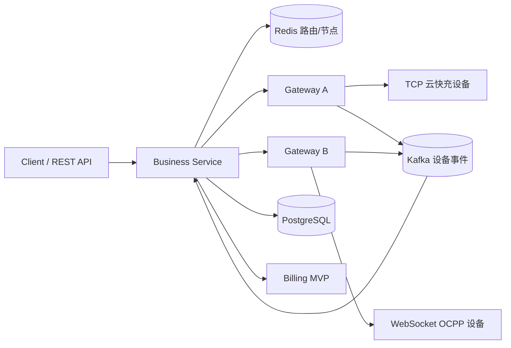
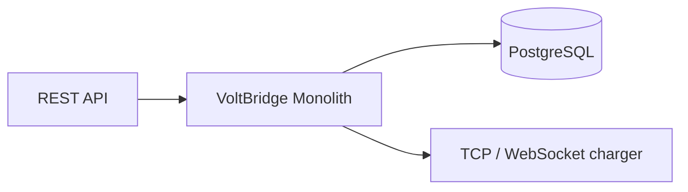

# VoltBridge

VoltBridge 是一个基于 Java 21 的电动汽车充电设备接入与运营后端原型。它以统一命令/事件模型接入协议，并提供充电交易和固定费率计费 MVP；并非已完成生产加固的产品。

## 支持协议与能力

- YunKuaiChong V1.5（TCP）与 OCPP 1.6J（WebSocket）。
- 设备命令、充电交易、固定费率账单、协议模拟器和端到端测试。
- 单体模式：进程内 Caffeine 会话/路由，不需要 Redis 或 Kafka。
- 分布式模式：Business 通过 Redis 定位 Gateway，使用 gRPC 下发，Gateway 通过 Kafka 回传设备事件。

## 架构



单体模式将 Business、Gateway 和内存路由装配在一个进程中：



## 快速开始（单体）

前提：JDK 21、Maven 3.9+、Docker Desktop。复制 `.env.example` 中的 PostgreSQL 参数；端口冲突时可先设置 `POSTGRES_PORT=15432`。

```powershell
docker compose -f deploy/docker-compose.yml up -d postgres
mvn -pl voltbridge-monolith-bootstrap -am spring-boot:run
```

默认端口：HTTP `8080`、云快充 TCP `9000`、OCPP WebSocket `9100`（路径 `/ocpp/{deviceCode}`）。单体不依赖 Redis/Kafka。

## 分布式 / 多 Gateway

```powershell
docker compose -f deploy/docker-compose.yml up -d
mvn -pl voltbridge-business-bootstrap -am spring-boot:run

$env:GATEWAY_NODE_ID='gateway-a'; $env:GATEWAY_GRPC_PORT='9090'; $env:TCP_PORT='9000'; $env:OCPP_WEBSOCKET_PORT='9100'
mvn -pl voltbridge-gateway-bootstrap -am spring-boot:run

$env:GATEWAY_NODE_ID='gateway-b'; $env:GATEWAY_GRPC_PORT='9092'; $env:TCP_PORT='9002'; $env:OCPP_WEBSOCKET_PORT='9102'; $env:GATEWAY_GRPC_ADVERTISED_PORT='9092'
mvn -pl voltbridge-gateway-bootstrap -am spring-boot:run
```

配置 `ROUTING_MODE=redis`（分布式默认值）后，Redis 保存 `device -> gateway node -> session` 路由及节点心跳；单体固定为 `local`，不访问 Redis。

## 模拟器与 API

模拟器入口是 `com.voltbridge.testing.simulator.scenario.ManualSimulatorMain`，详细步骤见 `docs/testing/device-simulator.md`、`docs/demo/charging-billing-demo.md` 和 `docs/demo/multi-gateway-demo.md`。REST API 概览见 `docs/release/api.md`；健康检查为 `/actuator/health`，指标为 `/actuator/metrics` 和 `/actuator/prometheus`。

## 测试

```powershell
mvn clean verify
# 显式使用本地 Redis 运行真实 Redis 验证
mvn -pl voltbridge-infra-cache,voltbridge-infra-rpc-grpc-client -am test "-Dredis.it.enabled=true" "-Dredis.it.host=localhost" "-Dredis.it.port=6379"
```

## 模块

`voltbridge-protocol-*` 为协议适配器，`voltbridge-transport-*` 管理连接，`voltbridge-device-gateway` 管理会话和路由，`voltbridge-business-*` 提供业务和 HTTP API，`voltbridge-infra-*` 提供 PostgreSQL/Redis/Kafka/gRPC 实现，`*-bootstrap` 为可执行装配模块。

## 已知限制

参见 [已知限制](docs/release/known-limitations.md) 和 [发布检查清单](docs/release/release-checklist.md)。

## 路线图

后续工作聚焦于版本化数据库迁移、分布式全进程场景自动化、TLS/认证与生产部署加固。

## 许可证

Licensed under the [Apache License, Version 2.0](LICENSE).
