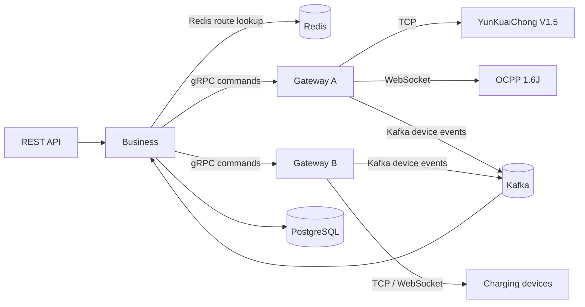

# VoltBridge

VoltBridge 是一个 **Java 21 电动汽车充电设备接入与运营后端原型**，面向工程学习和 portfolio 展示；它不是已经完成生产加固的商业平台。

项目通过统一设备命令与事件模型接入 YunKuaiChong V1.5/TCP 和 OCPP 1.6J/WebSocket，支持 Monolith 与 Distributed 两种运行组合、充电交易、版本化资费、计费记录、模拟器、OpenAPI 和分布式端到端验证。

## 能力范围

- **协议与运行形态：** YunKuaiChong V1.5 over TCP；OCPP 1.6J over WebSocket；Monolith 单进程组合，或独立 Business 与 Gateway 进程。
- **分布式路由：** Business 通过 Redis 查找设备所在 Gateway，通过 gRPC 下发设备命令；Gateway 通过 Kafka 回传设备事件。
- **交易与设备操作：** 统一的设备命令、Connector 状态和 ChargingTransaction 生命周期；设备连接状态与业务状态分离。
- **资费与 Billing：** `FALLBACK` / `SCHEDULED` 资费、不可变版本、`FIXED` / `TIME_OF_USE` 计价、真实 Meter Sample、Pricing Snapshot、Billing Record 与明细行。
- **开发与验证：** YKC/OCPP simulator、Business/Monolith REST OpenAPI、PostgreSQL/Kafka/Redis Testcontainers 分布式 E2E。

### 资费和账单

交易开始时间命中唯一的 `SCHEDULED` 资费时使用该版本；没有命中时自动解析租户的 `FALLBACK`。Fallback 固定为 `FIXED`、每天 `00:00–24:00` 覆盖，并通过新 revision 调价；不能普通退役或删除。

`SCHEDULED` 可使用 `FIXED` 或 `TIME_OF_USE`。TOU 时段必须完整覆盖每天 `00:00–24:00`，支持峰/平/谷，并基于真实累计 Meter Sample 在跨时段边界处分段计费。Pricing Snapshot 与 BillingLineItem 保留计价依据。**Billing 计算应收金额，不表示 Payment、Settlement 或 Refund。**

## 架构



Monolith 将 Business 与 Gateway 在同一进程组合，使用本地路由，不依赖 Redis 或 Kafka；仍使用 PostgreSQL 持久化。

## 快速开始：Monolith

需要 JDK 21 和 Docker。Maven 3.9.9 由 Maven Wrapper 下载。Monolith 最小依赖是 PostgreSQL；本地默认连接 `localhost:5432/voltbridge`。首次启动时 Flyway 从 `V1__baseline.sql` 初始化数据库。

```powershell
docker compose -f deploy/docker-compose.yml up -d postgres
.\mvnw.cmd -pl voltbridge-monolith-bootstrap -am package -DskipTests
java -jar .\voltbridge-monolith-bootstrap\target\voltbridge-monolith-bootstrap-0.1.0-SNAPSHOT.jar
```

默认 HTTP 端口为 `8080`，YKC TCP 为 `9000`，OCPP WebSocket 为 `9100`，路径为 `/ocpp/{deviceCode}`。本地开发默认数据库密码只用于开发，不应作为生产凭据。

## 分布式 / 多 Gateway

Distributed 需要 PostgreSQL、Kafka 和 Redis。Compose 可启动这三个本地依赖；应用仍用 PostgreSQL 保存业务数据。

```powershell
docker compose -f deploy/docker-compose.yml up -d
.\mvnw.cmd -DskipTests package
```

在一个终端启动 Business：

```powershell
java -jar .\voltbridge-business-bootstrap\target\voltbridge-business-bootstrap-0.1.0-SNAPSHOT.jar
```

分别在 Gateway A、B 终端启动两个 Gateway JVM。以下是 A 的示例；B 应使用另一组 gRPC、TCP 和 WebSocket 端口，并设置对应的 advertised gRPC 端口：

```powershell
$env:GATEWAY_NODE_ID='gateway-a'; $env:GATEWAY_GRPC_PORT='9090'; $env:GATEWAY_GRPC_ADVERTISED_PORT='9090'; $env:TCP_PORT='9000'; $env:OCPP_WEBSOCKET_PORT='9100'
java -jar .\voltbridge-gateway-bootstrap\target\voltbridge-gateway-bootstrap-0.1.0-SNAPSHOT.jar
```

可复制的 A/B 端口配置与设备连接步骤见[多 Gateway 演示指南](docs/demo/multi-gateway-demo.md)。

## Simulator、API 与开发数据

独立 simulator 支持 YKC 和 OCPP，包含长驻连接、周期 heartbeat 和重复充电周期。设备选择、构建命令及两个协议的启动示例见[设备模拟器指南](docs/testing/device-simulator.md)。本地 demo seed 需按[开发指南](docs/development.md)手工加载；应用启动和 Flyway 不会自动写入演示数据。

Business / Monolith REST API 提供 Swagger UI：`/swagger-ui.html`，OpenAPI JSON：`/v3/api-docs`。API 端点和示例见[REST API 文档](docs/release/api.md)。

## 数据库

Flyway 是唯一正式 schema 初始化路径；当前完整 schema 在单一 `V1__baseline.sql` 中，没有 V2 migration。`dev-seed.sql` 与 reset 脚本是显式的本地开发工具，不属于生产 migration。若本地数据库由旧版 V1 建立，应按[数据库迁移指南](docs/deployment/database-migrations.md)重建开发库，不要用 `flyway repair` 接受旧 checksum。

## 验证

```powershell
.\mvnw.cmd --batch-mode --no-transfer-progress clean verify
.\mvnw.cmd --batch-mode --no-transfer-progress -Pfull-e2e verify
```

`clean verify` 执行模块测试及 PostgreSQL Testcontainers migration/seed 验证。`full-e2e` 会启动真实 PostgreSQL、Redis、Kafka Testcontainers，并以独立 JVM 运行 Business、Gateway A/B 和 YKC/OCPP simulator，验证 gRPC 命令下发、Kafka 事件回流、交易完成和 Billing 闭环。详情见[分布式 E2E 指南](docs/testing/distributed-e2e.md)。

## 已知限制

- Gateway 强制崩溃后的 TTL 恢复和 Redis outage/chaos 自动化尚未完整覆盖。
- Billing 在交易提交后执行，目前没有 durable transactional outbox；失败可通过 retry API 恢复。
- 协议只覆盖 YKC V1.5 和 OCPP 1.6J 的当前命令/事件子集。
- 生产 TLS、认证授权、密钥管理、备份、监控告警和部署 HA 仍需加固。
- 不包含支付、退款、对账、结算、发票或完整 RBAC。

更多范围说明见[已知限制](docs/release/known-limitations.md)和[发布检查清单](docs/release/release-checklist.md)。

## 模块

`voltbridge-protocol-*` 实现协议适配，`voltbridge-transport-*` 管理连接，`voltbridge-device-gateway` 管理 Session 和路由，`voltbridge-business-*` 提供业务与 HTTP API，`voltbridge-infra-*` 提供 PostgreSQL/Redis/Kafka/gRPC 适配，`*-bootstrap` 组合可执行服务。

## License

Licensed under the [Apache License, Version 2.0](LICENSE).
