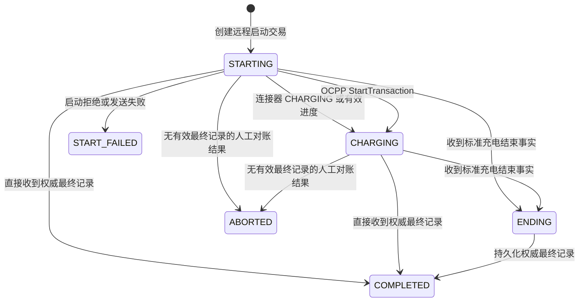
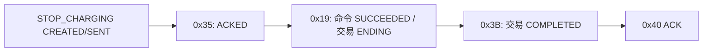
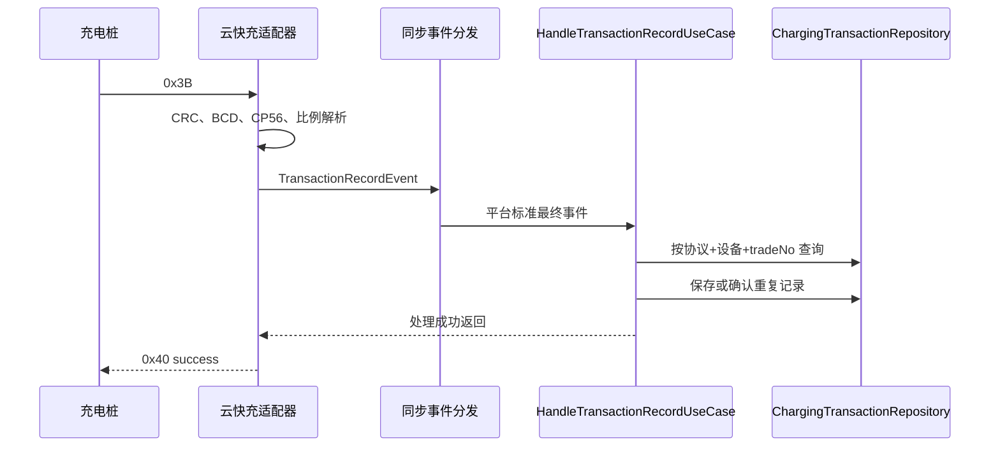

# 充电交易生命周期

## 领域边界

`ChargingTransaction` 表示一次连接器与车辆/用户之间的真实充电会话。它不是下发动作的 `DeviceCommand`，也不是订单、支付或结算单。当前聚合保存设备、连接器、协议、交易流水、业务引用、状态、起止时间、电表值、电量、SOC、时长、金额、VIN、启动方式、停止分类以及最终报文诊断快照。

金额、电量、电表值统一使用 `BigDecimal`；时间使用 `Instant`；标识使用 `UUID`。云快充原始停止码和诊断详情保留，但平台判断使用标准枚举。

## 状态机

- `COMPLETED` 表示已接受一份有效、权威的最终交易记录，不表示停止原因一定正常。
- 设备故障、BMS 故障、急停等仍为 `COMPLETED + stopCategory`；`ABORTED` 预留给始终没有有效最终记录的对账场景。
- `ChargingEndedEvent` 只推进到 `ENDING`，不能替代最终交易记录。
- `TransactionRecordEvent` 可以直接完成交易，不强制所有协议都经过 `ENDING`。
- 状态转换均为幂等；终态不会被普通进度报文重新打开。

## 命令与交易

远程启动时先持久化 `DeviceCommand(CREATED)` 和 `ChargingTransaction(STARTING)`，交易通过 `commandId` 与启动命令关联。协议接受结果把命令推进为 `ACKED` 并可绑定协议交易号；只有连接器进入充电、收到有效进度或开始交易事实，命令才变为 `SUCCEEDED`，交易才变为 `CHARGING`。命令此时结束，交易继续独立运行至 `COMPLETED`。

远程停止使用交易 UUID 作为 `STOP_CHARGING` 命令的 `businessRef`。协议接受结果只把停充命令置为 `ACKED`，不会修改交易和连接器；同一交易的标准结束事实到达后，交易进入 `ENDING`，对应停充命令才进入 `SUCCEEDED`。控制拒绝或超时均不改变交易，最终由标准权威交易记录推进到 `COMPLETED`。

## 关联与唯一性

解析优先级为：

1. 使用 `(protocol, device_id, protocol_transaction_id)` 精确查询。
2. 尚未绑定流水时，使用 `(device_id, connector_id)` 查询唯一活动交易并绑定 `tradeNo`。
3. 最终记录仍无匹配时，根据持久化设备和连接器恢复一条交易，再立即写入最终值。

数据库部分唯一索引 `uk_transaction_protocol_device_trade` 保证同一设备、协议和流水只有一条交易；`uk_transaction_active_connector` 保证同一连接器只能存在一个 `STARTING/CHARGING/ENDING` 交易。应用层解析与数据库约束共同处理并发。

## 进度持久化

高频 `ChargingProgressEvent` 完整保存在 Caffeine 运行态缓存。主交易表只在关键状态转换和最终记录到达时写入，避免每个实时帧都触发数据库更新。最终 `0x3B` 覆盖电表、电量、金额和起止时间等权威字段。

## 最终记录与幂等

同步分发保证 `0x40 success` 只在业务处理和持久化成功后发送。完全相同的重传返回成功且不重复写入；关键最终字段冲突时保留首份已接受记录、记录警告并返回成功，避免设备持续重传。该规则不会静默覆盖财务和电量数据。

## 数据库模型

`charging_transaction` 使用 `TIMESTAMPTZ`、`NUMERIC(20,6)` 和 `JSONB`。`raw_final_record` 保存不含敏感卡号的原始帧诊断快照；`additional_info` 保存分时电量、损耗电量等结构化扩展。物理卡号不进入日志和领域聚合。

查询 API：

- `GET /api/transactions/{transactionId}`
- `GET /api/transactions?deviceCode=...&connectorNo=...&status=...`

## 设备主动交易与整数协议号

`StartDeviceTransactionUseCase` 是协议无关的同步入口：若连接器存在远程启动创建的 `STARTING` 交易则复用，否则创建 `commandId=null` 的设备主动交易。它通过 `ProtocolTransactionIdAllocator` 获取持久化正整数，并调用聚合 `begin` 写入开始时间、电表和协议流水。

生产实现使用 PostgreSQL `protocol_transaction_id_seq`，不使用 hashCode、随机截断或进程内计数。OCPP 响应整数，领域仍用字符串 `protocolTransactionId` 统一保存，因此无需建立 `ocpp_transaction` 表。最终 `StopTransaction` 进入既有 `TransactionRecordEvent -> HandleTransactionRecordUseCase -> ChargingTransaction.finalizeRecord` 主线。
