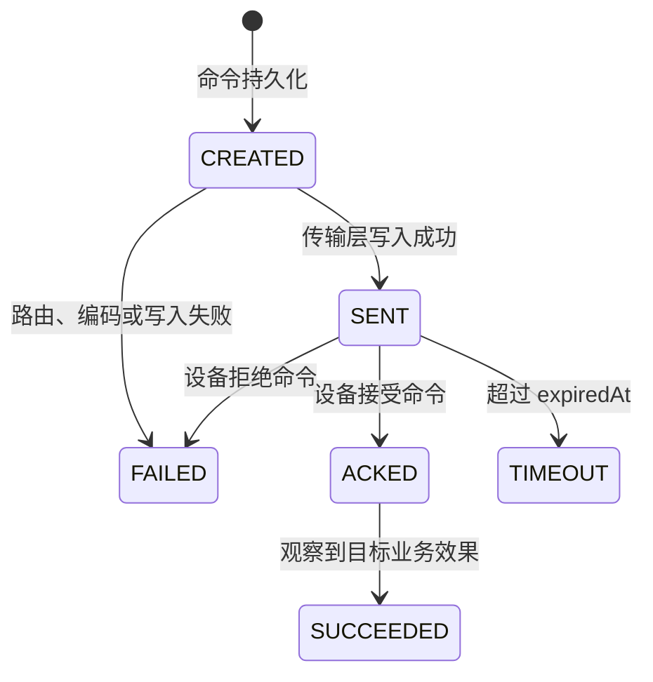
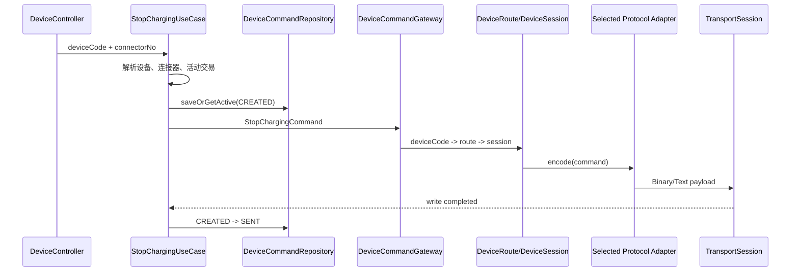
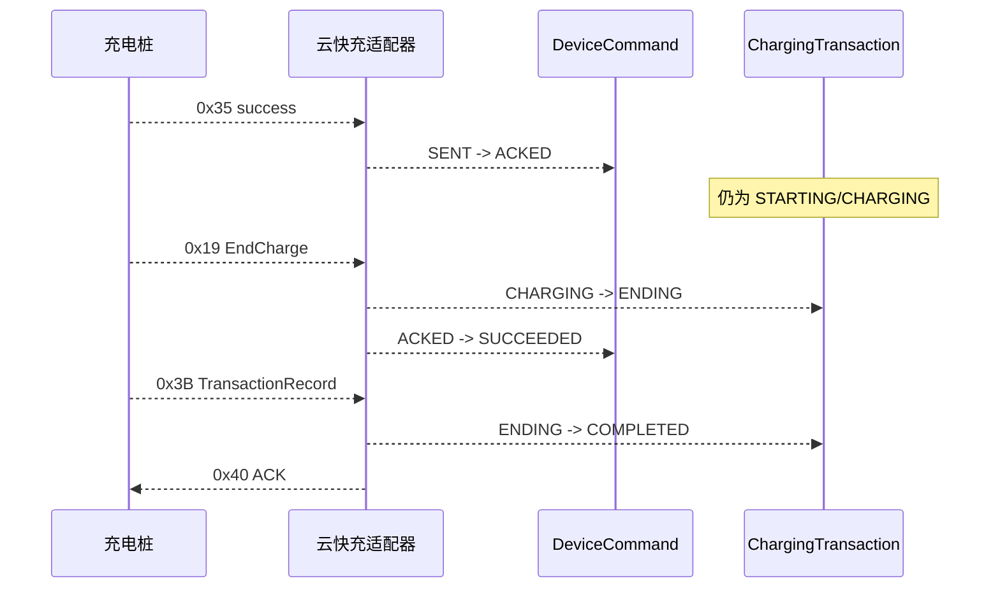

# 设备命令生命周期

## 领域模型

`DeviceCommand` 是可持久化业务命令聚合，保存租户、设备、连接器、命令类型、交易业务引用、请求/响应诊断快照、状态时间和失败信息。`device-api` 中的 `StartChargingCommand` 与 `StopChargingCommand` 是发往设备网关的协议无关消息，不包含传输会话、协议命令字、OCPP action、BCD 或 CRC。

启停入口分别为：

- `POST /api/devices/{deviceCode}/commands/start-charging`
- `POST /api/devices/{deviceCode}/commands/stop-charging`，请求体只包含 `connectorNo`
- `GET /api/commands/{commandId}` 统一查询两类命令

停充 API 选择设备与枪号，是因为当前领域已用 `(deviceId, connectorId)` 保证唯一活动交易；用例会精确解析该交易，不允许调用方传协议流水或会话信息。

## 状态机

- `SENT` 只表示字节成功写入活动会话。
- `ACKED` 只表示设备或协议接受请求，不表示真实世界动作已经发生。
- `EXECUTING` 表示协议明确报告命令仍在执行；没有该中间语义的协议可以跳过。
- 启动命令由 `0x33` 推进到 `ACKED`，由实际充电证据推进到 `SUCCEEDED`。
- 停充命令由 `0x35` 推进到 `ACKED`，由同一交易的 `0x19` 推进到 `SUCCEEDED`。
- OCPP 启动命令由 RemoteStartTransaction CALLRESULT 推进到 `ACKED`，由 StartTransaction 推进到 `SUCCEEDED`。
- OCPP 停止命令由 RemoteStopTransaction CALLRESULT 推进到 `ACKED`，由 StopTransaction 推进到 `SUCCEEDED`。
- `FAILED`、`TIMEOUT`、`SUCCEEDED` 是不可覆盖的历史终态；迟到结果只记录日志。
- 设备明确拒绝时会写入 `ackedAt`，因为平台确实收到了设备结果，同时写入失败码和原始协议码。

## 停充下行链路

无路由、会话缺失、连接代次不匹配和连接关闭统一映射为 `DEVICE_OFFLINE`，命令进入 `FAILED`，交易保持原状态，不主动反连设备。

## 结果与交易

不同协议的控制确认都只推进到 `ACKED`，不是物理充电结束；连接器状态也不会被手工改为可用。标准 `ChargingEndedEvent` 是停充效果证据，`TransactionRecordEvent` 是交易计量和金额的最终权威记录。云快充分别由 `0x19/0x3B` 产生两类事件，OCPP `StopTransaction` 可同时提供结束和最终记录证据。

## 超时、迟到与重复

- `voltbridge.device.command.remote-stop-timeout` 默认 `30s`，与通用 `CommandTimeoutService` 共用扫描器。
- 无 `0x35` 时仅将停充命令置为 `TIMEOUT`，交易保持活动。
- 超时后的 `0x35` 不回写历史状态；`HandleCommandResultUseCase` 记录迟到日志。
- 重复 `0x35` 由待处理注册表标记 `duplicate`，命令聚合拒绝重复转换。
- 同一交易已有 `CREATED/SENT/ACKED/EXECUTING` 停充命令时，重复 REST 请求返回原 `commandId`，不发送第二个 `0x36`。
- 前一命令 `FAILED/TIMEOUT` 后可重试；由于 `0x35` 不携带请求流水，设备、枪号上的迟到旧响应无法从协议上绝对区分，注册表按最新重试命令关联并记录该协议限制。

## 并发保护

用例在单体进程内串行完成“查活动交易—创建停充命令—发起分派”；数据库部分唯一索引 `uk_command_active_stop_transaction` 进一步保证同一交易只能存在一个非终态 `STOP_CHARGING`。约束命中时仓储返回既有命令，因此不需要 Redis 或分布式锁。

## 跨协议选择边界

`StartChargingUseCase` 与 `StopChargingUseCase` 不判断协议。它们产生统一命令后，由 `DeviceRouter -> ProtocolRegistry -> ProtocolAdapter` 选择云快充 `0x34/0x36` 或 OCPP `RemoteStartTransaction/RemoteStopTransaction`。因此 HTTP API、幂等规则、命令状态机和失败语义保持一致。
