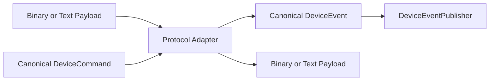

# 统一设备模型

## 业务对象与设备消息分离

VoltBridge 使用两套明确不同的模型：

- `business-domain` 中的实体表达租户、站点、设备、连接器、业务命令与充电交易。
- `device-api` 中的命令和事件表达平台与设备网关之间的协议无关消息。

业务 `DeviceCommand` 是需要持久化的聚合；`device-api.command.DeviceCommand` 是下行消息接口。二者不能合并，否则业务状态机会被协议传输细节污染。

## 统一身份

| 类型 | 含义 |
| --- | --- |
| `DeviceId` | 平台统一设备标识，与 `charging_device.device_code` 对应 |
| `ConnectorId` | 设备内连接器标识，承载平台 ID 与协议序号 |
| `DeviceProtocol` | 协议族和版本，不包含 TCP Channel 或命令号 |

## 统一下行命令

当前标准下行只包含已有完整业务生命周期的 `StartChargingCommand`、`StopChargingCommand`。具体云快充命令号/BCD/CRC，或 OCPP action/uniqueId/JSON payload，均由协议模块处理。尚无真实用例和适配器的 reset/tariff 不作为占位接口保留。

## 统一上行事件

`DeviceConnectedEvent`、`DeviceDisconnectedEvent`、`HeartbeatEvent`、`ConnectorStatusEvent`、`ChargingProgressEvent`、`ChargingEndedEvent`、`TransactionRecordEvent`、`CommandResultEvent` 构成业务可消费的稳定事件集合。充电开始不是协议命令 ID，而由连接器充电状态、有效进度或协议开始交易事实转成标准业务证据。

## OCPP 引入的协议无关扩展

- `ChargingProgressEvent` 增加标准功率 kW 和结构化诊断信息，云快充与 OCPP 共用。
- `DeviceTransactionStartService` 表达“设备主动开始交易”，支持无远程命令场景，不包含 OCPP action。
- `TransactionRecordEvent` 允许不同协议以各自时序提交权威最终记录；OCPP 可由 `StopTransaction` 直接完成。
- `protocolTransactionId` 保存协议侧稳定交易号：云快充为 tradeNo，OCPP 为平台分配整数的字符串形式。

OCPP `connectorId=0` 是设备级语义，不映射为平台物理连接器，也不会创建 `charging_connector #0`。

## 扩展原则

- 新协议通过新的 `ProtocolAdapter` 接入，不修改业务用例。
- 厂商私有字段优先保留在协议内部；只有稳定且有业务意义的字段才提升到统一模型。
- `DeviceEventPublisher` 是发布端口，当前由内存实现提供，未来 Kafka 实现不能改变调用方模型。
- Protobuf 是跨进程契约，不作为 Java 域模型的内部替代品。
- 标准失败码和停止分类保持有限且面向平台；OCPP 字符串、云快充数字码继续作为诊断元数据保留。
