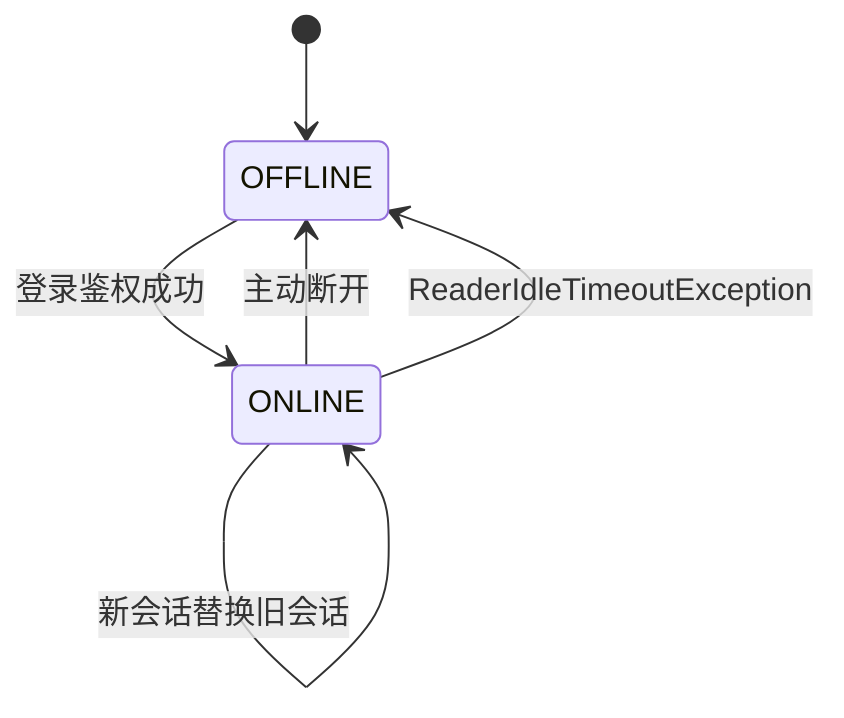

# 设备运行态设计

## 目标

设备注册资料、运营开关等稳定主数据与 TCP 在线状态、枪状态、充电进度分离。高频心跳和实时监测数据不直接更新 PostgreSQL 主表，避免热点行、乐观锁冲突和无意义 WAL 压力。

## 分层

| 数据 | 当前存储 | 说明 |
|---|---|---|
| 设备编码、站点、协议、厂商、业务启停状态 | `charging_device` | 稳定关系数据；登录时用于鉴权 |
| 连接器编号、类型、额定功率、业务启停状态 | `charging_connector` | 稳定关系数据；不承载秒级枪状态 |
| 在线状态、会话、`lastSeenAt` | `DeviceRuntimeStateStore` / Caffeine | 高频、短生命周期、可替换为 Redis |
| 枪状态 | `ConnectorRuntimeStateStore` / Caffeine | 按设备编码和连接器号索引 |
| 活跃充电进度 | `ConnectorRuntimeStateStore` / Caffeine | 保存最近一次实时快照，按交易流水关联 |
| 固件、信号、温度等非核心动态属性 | `device_attribute` | 仅在需要跨重启保留且更新频率可控时使用 |
| 原始历史遥测 | 尚未实现 | 后续进入时序库、Kafka 或历史事件表，不写主实体 |

`charging_device.status` 中现存 `ONLINE/OFFLINE` 取值仅为早期兼容约束；连接事件不再写入该列。后续数据库迁移应将该列收敛为纯业务状态枚举。

## 设备状态机

运行态以 `sessionId` 做代际保护。旧连接延迟到达的断开事件不能把新连接置为离线。

## 存储接口

- `DeviceRuntimeStateStore`：登录置在线、心跳刷新、断开置离线、查询在线数。
- `ConnectorRuntimeStateStore`：更新标准枪状态、保存活跃充电进度快照。
- 当前实现使用进程内 Caffeine；接口位于 `device-api`，未来可在不修改业务处理器的情况下替换为 Redis。

## 心跳与路由租约

心跳事件刷新业务运行态的 `lastSeenAt`。网关同时对每个已认证且成功解码的协议帧调用 `DeviceRouteDirectory.touch`，刷新路由租约。两者职责不同：前者服务业务可见状态，后者服务下行路由。

## 超时

Netty `IdleStateHandler` 使用 `voltbridge.device.session.idle-timeout`（可由 `TCP_READER_IDLE_TIMEOUT` 覆盖）。读空闲后生成 `ReaderIdleTimeoutException`、关闭连接并发出 `DeviceDisconnectedEvent`，业务运行态据此转为 `OFFLINE`，同时累加离线超时指标。

## 可观测性

- `voltbridge.device.connected`：当前在线设备数 Gauge。
- `voltbridge.device.heartbeat.events`：心跳计数。
- `voltbridge.device.offline.timeouts`：读空闲离线计数。
- `voltbridge.connector.status.changes`：枪状态变化计数。
- `voltbridge.charging.progress.events`：充电进度计数。

充电进度仅记录 DEBUG 摘要，不在 INFO 输出每一帧。
