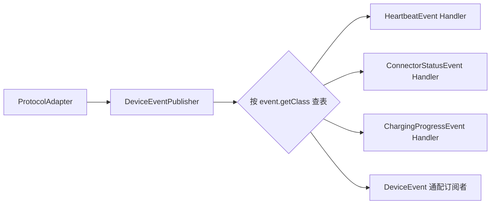

# 设备事件分发

## 设计

`DeviceEventHandler<E extends DeviceEvent>` 声明自身处理的事件类型。`InMemoryDeviceEventPublisher` 在启动时建立 `事件 Class -> 处理器列表` 注册表，发布时只调用精确匹配的处理器。

## 约束

- 业务处理器不编写全局 `if event instanceof ...` 链。
- 一个处理器只负责一种标准事件。
- 通配 `DeviceEvent` 处理器仅用于测试记录、审计桥接等横切场景。
- 协议 DTO 和数字状态码不得进入业务处理器。
- 新增 OCPP 等协议时复用标准事件；新增事件时只新增对应处理器和注册项。

## 当前处理器

| 处理器 | 事件 | 职责 |
|---|---|---|
| `HandleDeviceConnectedUseCase` | `DeviceConnectedEvent` | 运行态置 ONLINE |
| `HandleDeviceDisconnectedUseCase` | `DeviceDisconnectedEvent` | 会话保护后置 OFFLINE |
| `HandleHeartbeatUseCase` | `HeartbeatEvent` | 刷新 `lastSeenAt` |
| `HandleConnectorStatusUseCase` | `ConnectorStatusEvent` | 更新枪运行态 |
| `HandleChargingProgressUseCase` | `ChargingProgressEvent` | 保存进度并推断枪为 CHARGING |
| `HandleCommandResultUseCase` | `CommandResultEvent` | 维持既有命令生命周期 |
| `HandleTransactionCommandResultUseCase` | `CommandResultEvent` | 绑定协议交易号或记录启动失败 |
| `HandleTransactionConnectorStatusUseCase` | `ConnectorStatusEvent` | 以标准充电状态推进交易 |
| `HandleTransactionProgressUseCase` | `ChargingProgressEvent` | 以有效进度推进并更新交易 |
| `HandleChargingEndedUseCase` | `ChargingEndedEvent` | 推进交易到 ENDING |
| `HandleTransactionRecordUseCase` | `TransactionRecordEvent` | 幂等完成最终交易记录 |

当前内存发布器为同步分发。未来替换 Kafka 时，事件契约和业务处理器保持不变，但需要补充幂等键、重试与顺序策略。

云快充和 OCPP 发布相同的事件类型后进入完全相同的处理器注册表。协议差异只存在于事件产生前，不在事件分发器或业务处理器中通过协议分支恢复。
