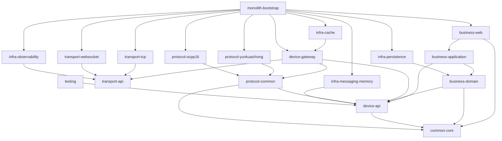

# Maven 模块依赖

## 最终依赖图

`contract-proto` 当前独立生成 Java 契约，只有未来的 gRPC/Kafka 边界适配器才应在生产代码中依赖它；业务域和设备 API 不依赖生成代码。该模块仅在测试作用域依赖 `device-api`，用于验证标准模型经过 Protobuf 序列化后可以无损往返。

## 模块职责

| 模块 | 职责 | 禁止依赖 |
| --- | --- | --- |
| `common-core` | 时间、通用结果等稳定原语 | Spring、Netty、协议实现 |
| `contract-proto` | 进程间命令、事件、路由契约 | 业务实现、网络运行时 |
| `device-api` | 统一设备模型及端口 | Netty、数据库、厂商协议 |
| `transport-api` | 连接、帧、服务抽象 | 设备业务、协议命令码 |
| `protocol-common` | 协议上下文、codec、协议 SPI | 网关实现、数据库 |
| `device-gateway` | 本地会话、路由、派发 | 业务 Web、持久化实现 |
| `transport-tcp` | Netty TCP 与端点拆帧 | 业务、协议实现、数据库 |
| `transport-websocket` | Netty WebSocket 握手、文本帧和连接生命周期 | OCPP 动作、业务、数据库 |
| `protocol-yunkuaichong` | 云快充 V1.5 二进制协议适配 | 网关实现、业务与数据库 |
| `protocol-ocpp16` | OCPP 1.6J 数组消息、动作与命令关联 | Netty、业务实现与数据库 |
| `business-domain` | 业务实体、规则、仓储端口 | Spring Web、传输、协议 |
| `business-application` | 用例编排 | 具体基础设施、协议实现 |
| `business-web` | REST 输入输出适配 | 领域逻辑、内部控制器调用 |
| `infra-persistence` | MyBatis-Plus 仓储实现 | Web、网关运行时 |
| `infra-cache` | Caffeine 路由目录实现 | Netty 活动对象 |
| `infra-messaging-memory` | 内存设备事件发布 | Kafka API |
| `infra-observability` | 指标、跟踪、健康检查 | 业务规则 |
| `monolith-bootstrap` | Spring 组合根 | 被下层模块反向依赖 |
| `testing` | 共享测试支撑 | 生产实现 |

## 有意保留的最小例外

- `business-domain -> device-api`：当前 `ChargingDevice` 直接使用统一的 `DeviceId`/`DeviceProtocol`，避免复制设备身份模型。
- `device-gateway -> transport-api`：本地 `DeviceSession` 必须持有抽象 `TransportSession`，但不依赖 Netty。
- `device-gateway -> protocol-common`：网关负责选择协议插件，SPI 已从网关移到协议公共模块，避免反向依赖。
- `infra-cache -> device-gateway`：缓存模块实现网关拥有的 `DeviceRouteDirectory` 端口。

## 自动边界保护

`voltbridge-monolith-bootstrap` 中的 ArchUnit 测试保护四条关键规则：业务领域不依赖协议/传输/基础设施实现，业务应用不依赖具体协议和网络运行时，传输不依赖业务应用，协议不依赖持久化实现。组合根可以依赖所有具体模块，但下层模块不得反向依赖组合根。
