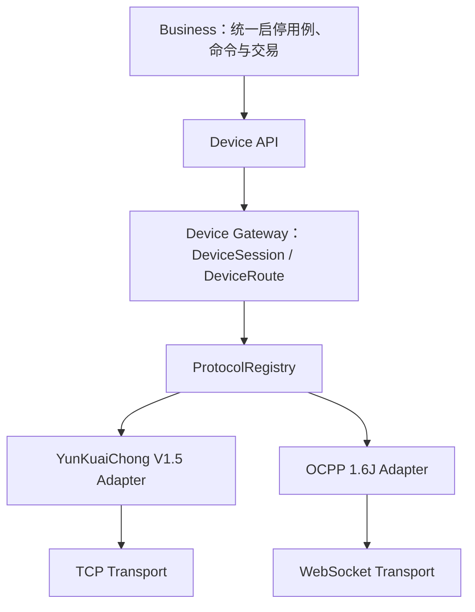

# 多协议统一架构

## 一个平台、两个适配器



两种协议共享设备、连接器、业务命令、标准设备命令、标准设备事件、会话、路由和充电交易。协议模块只拥有线格式、协议状态映射和线协议关联。

## 统一下行

```text
REST
 -> StartChargingUseCase / StopChargingUseCase
 -> StartChargingCommand / StopChargingCommand
 -> DeviceCommandDispatcher
 -> DeviceRoute -> DeviceSession
 -> ProtocolRegistry
    -> YunKuaiChong: 0x34 / 0x36 -> TCP
    -> OCPP 1.6J: RemoteStartTransaction / RemoteStopTransaction -> WebSocket
```

业务用例不读取 `DeviceProtocol` 来决定行为。路由中已认证的协议标识决定适配器；`SENT`、`ACKED`、`SUCCEEDED` 在两个协议中含义一致。

## 统一上行

```text
TCP/WebSocket message
 -> selected ProtocolAdapter
 -> canonical DeviceEvent
 -> typed DeviceEventPublisher
 -> shared application handlers
 -> shared ChargingTransaction / runtime state
```

云快充 `0x13` 与 OCPP `StatusNotification` 都产生 `ConnectorStatusEvent`；云快充实时数据与 OCPP `MeterValues` 都产生 `ChargingProgressEvent`。业务处理器不需要知道事件来源协议。

## 三类关联

| 关联 | 所有者 | 示例 |
| --- | --- | --- |
| 业务关联 | Business | `DeviceCommand.id`、`ChargingTransaction.id` |
| 设备路由 | Gateway | `deviceCode -> DeviceRoute -> DeviceSession` |
| 线协议关联 | Protocol | 云快充 sequence/tradeNo、OCPP uniqueId |

三类关联不得合并为一个通用 Map。协议原始结果码和停止原因保留为诊断信息，业务判断使用有限的标准失败码、`ChargingStopCategory` 和 `ConnectorStatus`。

## 扩展约束

- 新协议实现新的 `ProtocolAdapter` 并注册到 `ProtocolRegistry`，不能复制业务用例和交易聚合。
- 新传输实现 `TransportSession`，只能收发明确的 `BinaryTransportPayload` 或 `TextTransportPayload`。
- 新事件通过类型化处理器注册，不修改全局 `instanceof` 或 `hasXXX` 分支。
- 没有真实用例、协议实现和生命周期的命令不提前加入标准 API。
