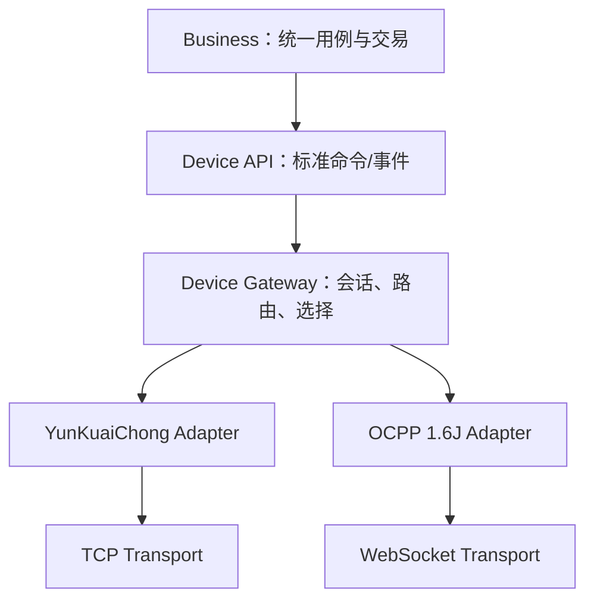

# 多协议架构审计

## 审计范围与结论

本审计覆盖 Maven 模块图、设备 API、设备网关、TCP/WebSocket 传输、云快充 V1.5/OCPP 1.6J 协议、业务领域与应用、持久化/缓存/内存消息/可观测性、单体组合根、Protobuf 契约及现有集成测试。

结论：VoltBridge 当前已经是“一个平台、两个协议适配器”，而不是两套充电系统。两种协议共享 `DeviceSession`、`DeviceRoute`、`DeviceCommand`、`DeviceEvent`、`ChargingTransaction`、业务用例和持久化表；协议差异被限制在协议编码、状态映射和线协议关联中。需要收敛的问题主要是契约漂移、无引用占位类型、二进制兼容入口以及少量过时文档/注释。

## GOOD

### 统一业务主线

- `StartChargingUseCase` 和 `StopChargingUseCase` 不判断 `DeviceProtocol`，只产生统一的 `StartChargingCommand`/`StopChargingCommand`。
- `DeviceCommandDispatcher` 按 `DeviceRoute.protocol` 从 `ProtocolRegistry` 选择适配器，不按命令类型或协议写不断扩张的分支。
- 云快充 `0x34/0x36` 与 OCPP `RemoteStartTransaction/RemoteStopTransaction` 共享同一命令生命周期：`CREATED -> SENT -> ACKED/EXECUTING -> SUCCEEDED`，失败和超时使用同一终态语义。
- 业务层只有一个 `ChargingTransaction` 聚合和一套 `STARTING/CHARGING/ENDING/COMPLETED/START_FAILED/ABORTED` 状态；没有 `OcppTransaction` 或 `YunKuaiChongTransaction`。
- 交易状态由“充电已开始、充电已结束、最终记录已到达”等标准事实推进，不由协议命令字直接推进。

### 会话、路由与关联

- `DeviceSession` 是唯一的平台设备会话，持有抽象 `TransportSession`，TCP 和 WebSocket 没有各自复制设备会话注册表。
- `DeviceRoute` 已包含 `gatewayNodeId + sessionId + connectionEpoch + protocol`，既满足当前单体，也为未来跨节点路由保留了可序列化模型。
- 业务关联、设备路由和线协议关联三类所有权清晰：业务使用命令/交易 UUID，网关维护 `deviceCode -> route -> session`，协议内部维护 sequence/tradeNo/uniqueId。
- OCPP pending request 与云快充 pending command 均位于各自协议模块，不替代统一设备路由。

### 传输与协议边界

- `TransportPayload` 用 `BinaryTransportPayload` 和 `TextTransportPayload` 明确表达二进制与文本，解决了 TCP 与 WebSocket 的真实差异，没有把协议 DTO 泄漏给传输层。
- `ProtocolAdapter` 只接收 `ProtocolContext + TransportPayload`，只输出标准事件、即时回复或标准命令载荷；业务不接触协议 DTO。
- Netty 的 `Channel`、`ChannelHandlerContext`、`ByteBuf`、WebSocket 帧类型仅存在于传输实现，没有泄漏到协议、网关和业务。
- `ProtocolRegistry` 构造时显式注册并校验协议和端点唯一性，协议选择集中、可测试。

### 事件与持久化

- `InMemoryDeviceEventPublisher` 使用事件类型注册表，不使用全局 `instanceof` 链；两个协议发布相同事件后进入相同处理器。
- PostgreSQL 只保留协议无关的 `charging_device`、`charging_connector`、`device_command`、`charging_transaction` 等核心表，没有协议专属业务表。
- `charging_device.protocol/protocol_version` 集中保存协议身份；协议原始诊断数据进入标准字段或 JSONB，而不是复制业务模型。
- schema 字段说明直接写在建表语句中，没有独立 `COMMENT ON` 补丁。

## ACCEPTABLE

- `DeviceSessionRegistry`、`DeviceRouteDirectory` 和 `GatewayConnectionCoordinator` 当前各只有本地实现，但它们分别隔离活动连接、可替换路由存储和传输回调，具有明确的 Phase 10 边界价值，保留合理。
- `ProtocolInboundResult` 同时承载标准事件、无需业务决策的协议即时回复和认证请求。三者都属于“一次入站消息处理结果”，当前规模下保持一个不可变返回值比拆成多个接口更清晰。
- `ProtocolContext` 暴露协议序列供应器与传输握手属性。它不暴露网关或 Netty 对象，且两种协议确有不同使用方式，属于协议层必要上下文。
- 组合根以 `@SpringBootApplication(scanBasePackages = "com.voltbridge")` 发现实现，同时通过模块依赖和少量显式 Bean 完成装配。当前仍可理解，但重要边界应继续由依赖测试保护，避免未来完全依赖隐式扫描。
- `DeviceProtocol` 保存在业务设备和交易中作为身份/审计数据是合理的；禁止的只是基于具体协议实现业务分支。
- `infra-cache -> device-gateway` 用于实现网关拥有的路由端口，方向虽是基础设施依赖应用边界，但符合端口适配模式。

## REFACTOR

### 契约收敛

- `contract-proto` 仍包含未实现的 reset/tariff 命令以及已被标准交易事件取代的 `TransactionStartedEvent`/`TransactionEndedEvent`，同时缺少当前 Java 命令和事件的关键关联字段。应让 Proto 对齐现行标准模型，并用 `oneof` 保持互斥消息体。
- 为 `DeviceConnectedEvent`、`HeartbeatEvent`、`ConnectorStatusEvent`、`ChargingProgressEvent`、`CommandResultEvent`、`StartChargingCommand`、`StopChargingCommand` 增加序列化往返测试，验证事件 ID、命令 ID、设备 ID、交易关联和时间字段不丢失。
- 业务注释中“TCP 写入/下发”应改为“传输写入/下发”，避免文档层面把 WebSocket 排除在共享主线之外。

### 小型 API 清理

- `ProtocolAdapter.decode(context, byte[])` 是单协议阶段遗留的二进制兼容入口；当前所有生产调用都使用 `TransportPayload`，应删除。
- `TransportFrame(sessionId, byte[], receivedAt)` 与 `TransportSession.send(byte[]/String)` 是便利兼容入口。生产代码应显式构造二进制或文本载荷，使载荷类型在调用点可见；确认无调用后删除。
- TCP 收帧处应显式创建 `BinaryTransportPayload`，与 WebSocket 显式创建 `TextTransportPayload` 对称。
- 架构文档仍把部分能力描述为只有登录或只列云快充链路，应更新为两协议完整主线，并补充未来服务边界。

### 边界保护

- 增加少量 ArchUnit 规则：业务领域禁止依赖协议/传输/基础设施实现；业务应用禁止依赖 Netty、具体协议、Kafka、gRPC；传输禁止依赖业务应用；协议禁止依赖持久化。
- 增加双协议架构级命令测试，证明同一个启停用例产生标准命令，再由设备路由选择云快充或 OCPP 适配器。

## REMOVE

- `ProtocolMessage`：没有引用，且无法表达文本协议，已被 `TransportPayload` 和各协议内部消息模型替代。
- `ResetDeviceCommand`、`SetTariffCommand`：没有用例、适配器或持久化生命周期支撑，是过早占位，不应作为“看起来可扩展”的标准命令保留。
- `TransactionStartedEvent`、`TransactionEndedEvent`：没有发布者和处理器，且当前真实主线已使用充电证据、`ChargingEndedEvent` 和 `TransactionRecordEvent`。
- `TraceContext`：无引用的静态 ThreadLocal 占位，未形成可观测性方案，保留会误导后续调用方。
- 上述二进制/文本兼容重载和构造器：确认没有生产或测试依赖后删除，不保留无消费者的兼容代码。

## DEFER

- Redis 路由实现、跨节点租约协调和活动会话迁移。
- Kafka 设备事件运行时、消费重试、分区顺序和死信策略。
- gRPC 服务端/客户端运行时以及 Business/Gateway 进程拆分。
- OCPP 2.0.1、OCPP 2.1、MQTT 和第三种协议。
- 支付、结算、完整费率模型及管理前端。
- 将协议线关联持久化；当前内存关联符合单体阶段，拆分时再依据重启恢复要求设计。

## 最终目标边界

未来拆分仅允许标准 `DeviceEvent` 从 Gateway 发往 Business、标准 `DeviceCommand` 从 Business 发往 Gateway。边界消息不得包含 Netty 对象、Spring Bean、数据库实体、协议 DTO 或 `TransportSession`。
