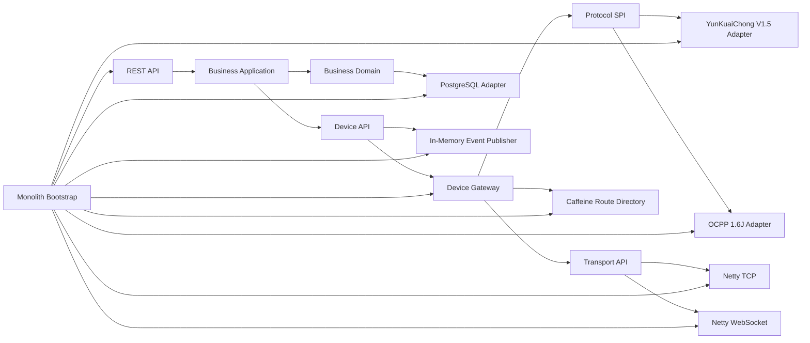

# VoltBridge 目标架构总览

## 阶段边界

当前单体已完成云快充 V1.5 TCP 与 OCPP 1.6J WebSocket 两条真实协议主线，复用同一设备会话、路由、命令、事件和充电交易模型。Kafka、Redis 分布式路由、gRPC 拆分和 OCPP 2.x 仍不在当前阶段范围内。

## 核心边界

- **业务域**：保存充电业务实体、仓储端口和命令生命周期，不感知协议与网络。
- **设备 API**：定义协议无关的设备标识、命令、事件和端口，是业务与网关的稳定语言。
- **设备网关**：管理本进程会话、逻辑设备路由、协议选择和命令派发。
- **传输层**：管理连接、完整帧收发和连接生命周期，不解释帧的业务含义。
- **协议层**：在完整协议消息与统一设备命令/事件之间转换；云快充负责二进制命令字，OCPP 负责 JSON action 与 uniqueId。
- **基础设施**：实现数据库、缓存、消息、指标与健康检查端口。
- **契约层**：定义未来进程间通信的数据契约，不在当前单体中启动 gRPC。
- **启动层**：唯一组合根，可以依赖全部具体实现模块。

## 关键决定

1. `DeviceSession` 是本地活动连接，只保存在网关进程内。
2. `DeviceRoute` 是可序列化路由元数据，不持有 Netty 对象。
3. TCP 端点配置决定拆帧规则；协议插件只解析完整帧。
4. 协议 SPI 位于 `protocol-common`，避免协议实现反向依赖网关。
5. 业务命令的“网络发送成功”“设备接受”和“业务效果发生”是不同状态。
6. PostgreSQL 不创建 `device_session` 表，瞬时在线状态不当作业务事实持久化。
7. 未来服务边界只传输标准 `DeviceCommand`/`DeviceEvent` Protobuf Envelope，不传输会话、协议 DTO 或数据库实体。

## 当前可运行能力

应用可在一个 JVM 内同时装配 HTTP、云快充 TCP、OCPP WebSocket、PostgreSQL、Caffeine、内存事件发布与可观测性组件。`LocalGatewayConnectionCoordinator` 统一编排两种传输；业务认证成功后才激活会话和设备路由。详见 [OCPP 1.6J 概览](../protocol/ocpp16/overview.md)。
