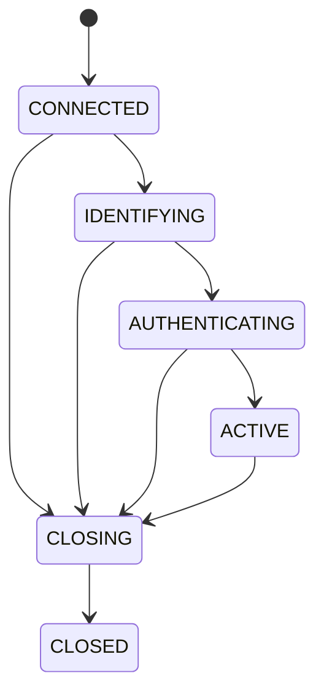
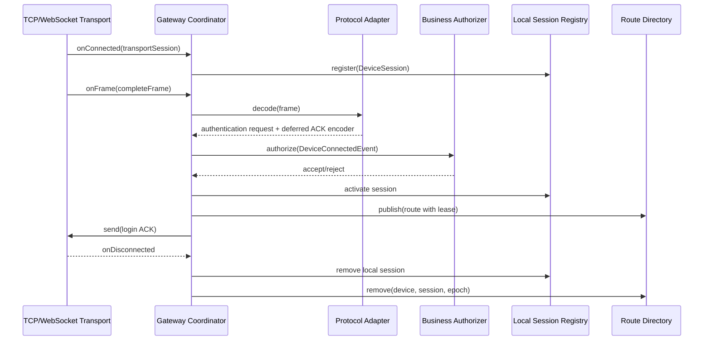

# 会话与设备路由

## 两种对象

### DeviceSession

`DeviceSession` 表示当前网关 JVM 内的一条真实设备连接，持有抽象 `TransportSession`、本次连接的 `connectionEpoch`、已识别设备、协议、序列号和状态。它只能存放在 `LocalDeviceSessionRegistry`，不得进入 PostgreSQL、Redis 或 Protobuf。

### DeviceRoute

`DeviceRoute` 表示逻辑设备当前应被哪个网关会话处理，只包含可序列化数据：

- `deviceId`
- `gatewayNodeId`
- `sessionId`
- `connectionEpoch`
- `protocol`
- `authenticatedAt`
- `lastSeenAt`
- `leaseExpiresAt`

单体由 `CaffeineDeviceRouteDirectory` 实现；分布式多 Gateway 由 `RedisDeviceRouteDirectory` 实现。后者增加 `gatewayNodeInstanceId`，并以 `nodeId + instanceId + sessionId + connectionEpoch` 做刷新和删除围栏。

## 会话状态机



只有 `ACTIVE` 会话允许下行命令。`connectionEpoch` 为每次连接生成的新代次，用于阻止旧连接断开事件删除新连接发布的路由。

## 路由并发语义

1. 登录认证成功后，网关先激活本地会话，再原子声明带租约的 `DeviceRoute`。
2. 心跳或有效上行通过 `touch(deviceId, sessionId, epoch, ...)` 延长租约。
3. 下行查询时，`DeviceRouter` 拒绝过期路由。
4. 断开时使用 `remove(deviceId, sessionId, epoch)` 条件删除。
5. Caffeine 中的新旧路由竞争以认证时间选择较新连接；任何删除都必须匹配会话与代次。



该协调过程已由 `LocalGatewayConnectionCoordinator` 实现。认证拒绝时发送失败 ACK 后关闭连接，不发布路由和连接事件。同一设备的新有效登录覆盖旧路由；旧连接断开时因 `gatewayNodeId + nodeInstanceId + sessionId + connectionEpoch` 不匹配，不能删除新路由，也不会把设备误标记为离线。详见 [多 Gateway 路由](multi-gateway-routing.md)。

## 下行路由

`DeviceCommandDispatcher` 先读取当前单体的本地 `DeviceRoute`，再确认会话仍存在、设备/协议/代次均匹配且状态为 `ACTIVE`，最后调用对应 `ProtocolAdapter.encode` 并通过 `TransportSession.send` 写出。网络写入完成只表示 `SENT`，不表示设备执行成功。

云快充远程启动的精确下行路径是：

```text
StartChargingUseCase
  -> DeviceCommandGateway(DeviceCommandDispatcher)
  -> DeviceRouter: deviceCode -> DeviceRoute
  -> DeviceSessionRegistry: sessionId -> DeviceSession
  -> ProtocolRegistry: DeviceProtocol -> YunKuaiChongProtocolAdapter
  -> YunKuaiChongOutboundCommandRouter
  -> YunKuaiChongRemoteStartEncoder
  -> TcpTransportSession.send(0x34)
```

分派器逐项校验路由租约、本地节点、会话、连接代次、设备身份、协议和传输连接。任一条件失效都按 `DEVICE_OFFLINE` 失败，不创建伪连接，也不主动反连充电桩。

`YunKuaiChongPendingCommandRegistry` 只保存可序列化的命令关联信息，不保存 Netty Channel 或 `DeviceSession`。它属于协议模块，不能替代设备路由目录；路由负责“发到哪条连接”，待处理注册表负责“收到 `0x33` 后更新哪条业务命令”。

## OCPP 会话复用

WebSocket 握手成功后同样创建 `DeviceSession`，但会话只持有路径 `deviceCode` 属性，尚未激活。BootNotification 接受后才执行 `session.activate` 和 `DeviceRoute.publish`。最终路由保持统一链路：

```text
deviceCode -> DeviceRoute -> sessionId -> DeviceSession -> TransportSession
```

最后一段可为 `TcpTransportSession` 或 `WebSocketTransportSession`，差异不进入业务层。OCPP 下行由路由中的 `DeviceProtocol.OCPP_16` 选择 `Ocpp16ProtocolAdapter`；协议短期关联表只解释 CALLRESULT 属于哪个命令，不参与设备路由。

## 未来拆分约束

Gateway Service 始终独占 `DeviceSession` 和本地 `TransportSession`。可跨进程传播的是 `DeviceRoute` 的值数据与标准命令/事件，不允许把活动连接序列化到 Redis、Protobuf 或数据库。Business 通过 Redis 解析路由和节点后，以 gRPC 调用拥有该会话的 Gateway。
