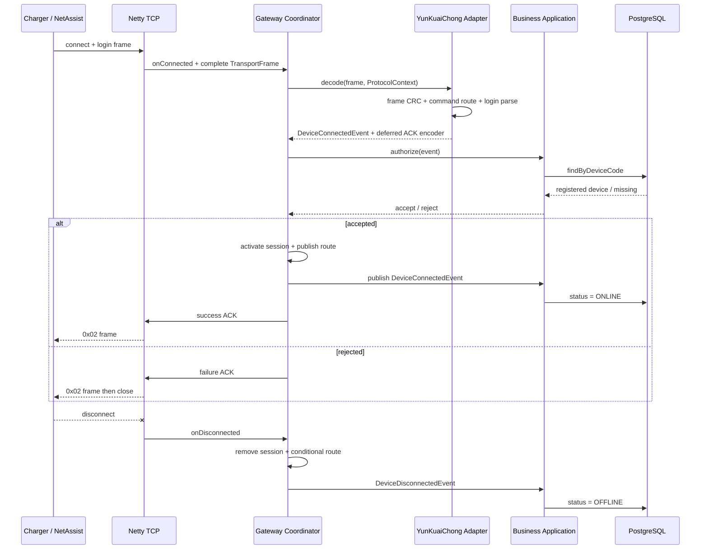

# YunKuaiChong V1.5 TCP 登录闭环

## 范围

本阶段只实现登录上行 `0x01`、业务认证和登录应答 `0x02`。不包含远程启停、心跳业务、充电过程或交易记录。

## 运行流



## 已知登录报文

```text
6822001900012023121200001001011047562E393572313300898604D11722D0348606024E87
```

解析结果：

| 字段 | 值 |
| --- | --- |
| 帧头 | `0x68` |
| 数据域长度 | `0x22`（34 字节） |
| 序列号 | `0x0019`（25） |
| 加密标志 | `0x00` |
| 命令 | `0x01` |
| 设备编码 | `20231212000010` |
| 桩类型 | `0x01` |
| 枪数量 | `1` |
| 通信版本原始值 | `0x10` |
| 程序版本 | `GV.95r13` |
| 网络类型 | `0x00` |
| SIM 原始十六进制 | `898604D11722D0348606` |
| 运营商 | `0x02` |
| CRC | `0x4E87` |

## 帧与 CRC 策略

- 长度字段表示“序列号 2 字节 + 加密标志 1 字节 + 命令 1 字节 + 消息体”。完整帧长度为 `length + 4`。
- CRC 覆盖序列号起始到消息体结束，算法为 CRC16/MODBUS：初始值 `0xFFFF`，反射多项式 `0xA001`。
- 序列号和 CRC 在线路上均严格按已知样例的高字节在前解析和编码。
- VoltBridge 使用单一、可测试的 CRC 与序列号字节序基准，不采用猜测式双字节序兼容策略。

## 登录应答

成功应答包含原序列号、命令 `0x02`、7 字节设备编码和结果 `0x00`：

```text
680C00190002202312120000100055A1
```

失败应答结构相同，结果字节为 `0x01`，发送完成后关闭连接。ACK 由协议层编码，但是否成功由业务层的 `DeviceConnectionDecision` 决定；业务层不持有 Channel，也不接触云快充对象。

## 会话与重复登录

1. TCP 接入时只创建 `sessionId -> DeviceSession`，此时设备身份未知。
2. 登录帧解析后，业务应用按 `deviceCode` 查询注册设备并校验协议和禁用状态。
3. 认证成功后建立 `deviceCode -> DeviceRoute -> sessionId -> DeviceSession -> TransportSession`。
4. 同一设备的新有效登录覆盖旧路由，成功 ACK 发出后关闭旧连接。
5. 路由删除必须同时匹配 `sessionId` 和 `connectionEpoch`，因此旧连接断开不能删除新连接路由。
6. 仅当前活动路由被成功删除时才发布断开事件，避免重复登录切换期间把设备误写为 OFFLINE。

## 扩展方式

`YunKuaiChongCommandRouter` 按命令号注册 `YunKuaiChongCommandHandler`。后续心跳、远程启动结果、充电进度和交易记录各自新增处理器，不修改巨型 `switch`。统一下行命令仍通过 `ProtocolAdapter.encode` 扩展，本阶段未实现 Remote Start。
