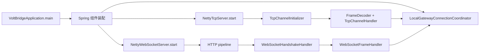
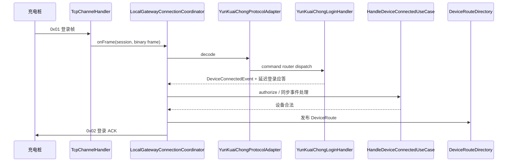
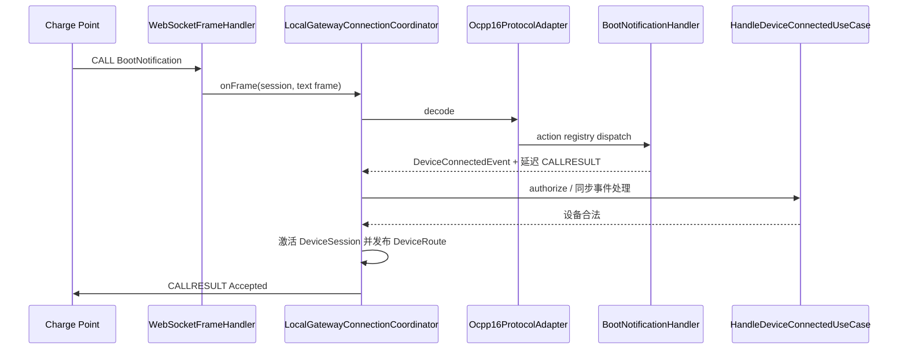
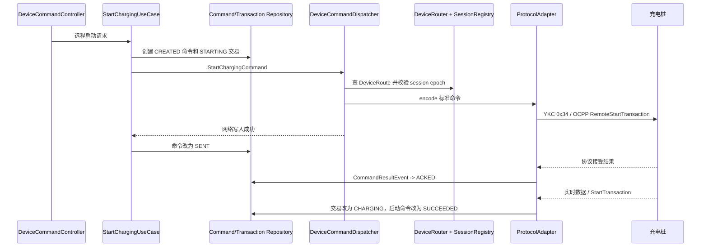
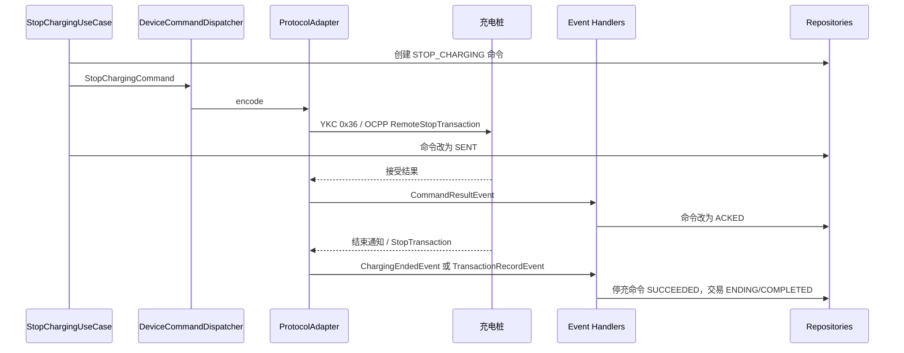
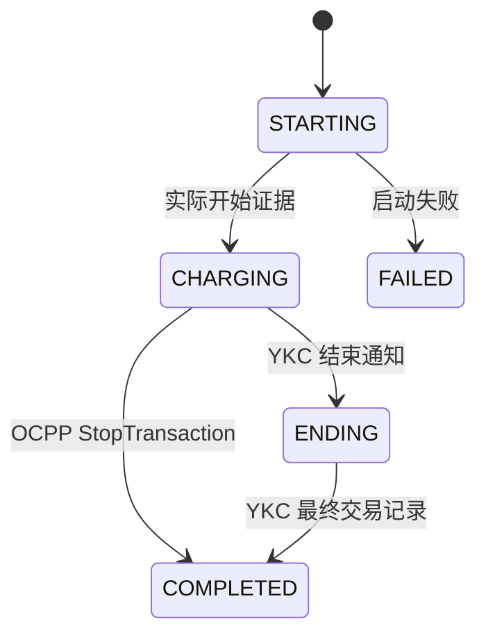
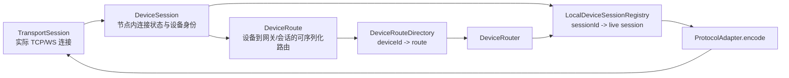

# Recommended Reading Order

本文面向第一次阅读 VoltBridge 的开发者，按“边界抽象 → 启动装配 → 上行接入 → 下行业务 → 交易收敛 → 基础设施”的顺序阅读。不要先从某个协议报文处理器推测整体架构。

## 1. 推荐阅读顺序

| 顺序 | 模块 | 先读类 | 关注点 |
|---|---|---|---|
| 1 | `voltbridge-transport-api` | `TransportSession`、`TransportFrame`、`TransportConnectionListener` | 物理连接与原始负载边界 |
| 2 | `voltbridge-device-api` | `DeviceEventPublisher`、`DeviceCommandGateway` | 标准事件与标准命令边界 |
| 3 | `voltbridge-protocol-common` | `ProtocolAdapter`、`ProtocolDecodeResult` | 协议如何与设备模型隔离 |
| 4 | `voltbridge-monolith-bootstrap` | `VoltBridgeApplication`、`VoltBridgeCoreConfiguration` | 单体进程的 Spring 组合根 |
| 5 | `voltbridge-transport-tcp` / `voltbridge-transport-websocket` | `NettyTcpServer`、`NettyWebSocketServer` | 网络入口如何产生传输会话和帧 |
| 6 | `voltbridge-device-gateway` | `LocalGatewayConnectionCoordinator`、`ProtocolRegistry`、`DeviceCommandDispatcher` | 上下行汇合点、认证和路由 |
| 7 | 两个协议模块 | `YunKuaiChongProtocolAdapter`、`Ocpp16ProtocolAdapter` | 原始协议与标准模型互转 |
| 8 | `voltbridge-business-application` | `StartChargingUseCase`、`StopChargingUseCase`、交易事件处理器 | 命令与交易状态推进 |
| 9 | `voltbridge-business-domain` | `DeviceCommand`、`ChargingTransaction` | 状态机和业务不变量 |
| 10 | `voltbridge-infra-*` | MyBatis 仓储、Redis 路由/节点注册、Caffeine 单体路由 | 端口的当前实现方式 |

## 2. 模块边界速览

- **transport**：维护实际连接，只认识二进制或文本负载，不认识充电协议和业务。
- **protocol**：把原始负载解析成协议 DTO，再转换为标准事件；把标准命令编码成协议负载。
- **device-gateway**：管理连接认证、节点内会话、设备路由和协议选择，是上下行的汇合边界。
- **business**：维护设备、命令和充电交易，不依赖 Netty、YKC 或 OCPP 的 DTO。
- **infrastructure**：实现数据库、节点内缓存、同步事件总线和观测端口，不反向定义领域语义。
- **bootstrap**：只负责装配并启动当前单体，不承载业务规则。

## 3. 启动路径

入口为 `VoltBridgeApplication.main`。Spring 完成 Bean 装配后，`NettyTcpServer` 与 `NettyWebSocketServer` 通过 `SmartLifecycle` 自动启动。两者使用最大 phase，目的是最后启动网络入口、最先关闭网络入口。

关键类的完整包名：

| 职责 | 完整类名 |
|---|---|
| Spring Boot 入口 | `com.voltbridge.bootstrap.VoltBridgeApplication` |
| 通用时钟配置 | `com.voltbridge.bootstrap.VoltBridgeCoreConfiguration` |
| TCP 监听器 | `com.voltbridge.transport.tcp.NettyTcpServer` |
| WebSocket 监听器 | `com.voltbridge.transport.websocket.NettyWebSocketServer` |
| 连接协调器 | `com.voltbridge.gateway.session.LocalGatewayConnectionCoordinator` |
| 协议注册表 | `com.voltbridge.gateway.protocol.ProtocolRegistry` |
| 事件分发器 | `com.voltbridge.gateway.event.DeviceEventDispatcher` |

`VoltBridgeApplication` 从 `com.voltbridge` 根包扫描当前单体的所有模块。协议适配器以 Spring Bean 形式注入 `ProtocolRegistry(List<ProtocolAdapter>)`；业务事件处理器实现 `DeviceEventHandler<T>`，由 `InMemoryDeviceEventPublisher(List<DeviceEventHandler<? extends DeviceEvent>>)` 按事件类型建立同步处理器表。TCP 与 WebSocket 服务器接收 `List<TransportConnectionListener>`，当前由 `LocalGatewayConnectionCoordinator` 统一承接。

关键点：

1. `NettyTcpServer` 监听 YKC TCP 端点，`TcpFrameDecoderFactory` 根据 endpoint 安装帧解码器。
2. `NettyWebSocketServer` 独立于 Spring MVC，校验 URL `/ocpp/{deviceCode}` 和子协议 `ocpp1.6`。
3. `TcpChannelHandler` / `WebSocketFrameHandler` 只转换为 `TransportSession` 与 `TransportFrame`。
4. 两种传输最终都回调同一个 `LocalGatewayConnectionCoordinator`。

## 4. 登录与上线

### 4.1 云快充登录

阅读路径：

`TcpChannelHandler.channelRead0` → `LocalGatewayConnectionCoordinator.onFrame` → `YunKuaiChongProtocolAdapter.decode` → `YunKuaiChongCommandRouter.route` → `YunKuaiChongLoginHandler.handle` → `LocalGatewayConnectionCoordinator.authenticate`。

登录 ACK 被有意延迟到业务鉴权成功之后发送。协议识别出设备号不等于平台已经允许该设备上线。

### 4.2 OCPP BootNotification

WebSocket URL 中的设备号只是候选身份。`BootNotificationHandler` 产生标准 `DeviceConnectedEvent`，最终仍由网关协调器完成认证、会话激活和路由发布。

## 5. 上行主线

所有上行都遵循同一方向：

`原始传输负载 → 协议帧/JSON DTO → 标准 DeviceEvent → 业务事件处理器 → 领域聚合/运行态`。

- YKC：`YunKuaiChongProtocolAdapter` 先调用 `YunKuaiChongFrameCodec`，再由 `YunKuaiChongCommandRouter` 按命令字选处理器。
- OCPP：`Ocpp16ProtocolAdapter` 先由 `Ocpp16FrameCodec` 解析消息类型；CALL 交给 `Ocpp16ActionHandlerRegistry`，CALLRESULT/CALLERROR 通过待处理请求关联。
- 标准事件由 `DeviceEventDispatcher` 发布到 `InMemoryDeviceEventPublisher`。当前实现是进程内同步调用，因此协议成功应答可以表达“业务处理已经成功返回”。

不要让协议 DTO 进入业务模块，也不要让业务事件处理器读取 Netty Channel。

## 6. 远程启动

REST 入口是 `DeviceCommandController`，业务入口是 `StartChargingUseCase.execute`。

状态语义：

- `CREATED`：请求已经持久化，尚未确认写入设备连接。
- `SENT`：负载已经交给当前传输会话，不表示设备接受。
- `ACKED`：设备接受远程启动请求，不表示车辆已开始充电。
- `SUCCEEDED`：收到真实充电证据。YKC 通常来自实时数据，OCPP 来自 `StartTransaction`。

协议关联：

- YKC 使用交易流水号，由 `YunKuaiChongPendingCommandRegistry` 将 0x33 结果关联到平台 `commandId`。
- OCPP 使用 `uniqueId`，由 `Ocpp16PendingRequestRegistry` 关联 CALLRESULT/CALLERROR。

## 7. 远程停止

业务入口是 `StopChargingUseCase.execute`，它先找到连接器上的唯一活动交易，并以交易 ID 保证重复停充请求幂等。

YKC 的 0x35 不携带请求流水，`YunKuaiChongPendingCommandRegistry` 只能按设备、枪号和命令类型关联最近待处理停充命令，这是协议限制下的降级关联。OCPP 的远程停充下行必须使用已经绑定的数值 `transactionId`。

## 8. 交易收敛

`ChargingTransaction` 是跨协议统一的充电交易聚合。平台 UUID、协议交易号和命令 UUID 是三个不同概念，不能混用。

- `ChargingTransactionResolver` 优先使用 `protocol + deviceId + protocolTransactionId` 精确查找。
- 远程启动交易尚未绑定协议交易号时，解析器才回退到连接器上的唯一活动交易并绑定流水。
- `ChargingStartedService` 同时推进交易到 `CHARGING`，并把关联启动命令完成为 `SUCCEEDED`。
- `HandleChargingEndedUseCase` 只推进到 `ENDING`，最终金额、电量和结束表底由 `HandleTransactionRecordUseCase` 收敛。
- `StartDeviceTransactionUseCase` 处理 OCPP 设备主动启动，并通过 `PostgreSqlProtocolTransactionIdAllocator` 分配可持久恢复的数值交易号。

## 9. 会话与设备路由

三个对象的职责不可互换：

- `TransportSession`：真实连接和发送能力，仅存在于拥有连接的节点内。
- `DeviceSession`：包装 `TransportSession`，保存识别、认证、激活状态及 session epoch，同样仅限节点内。
- `DeviceRoute`：不持有连接对象，只记录 `deviceId / gatewayId / sessionId / epoch / protocol` 等路由元数据。

设备重连时会产生新的 epoch。清理旧连接时，`LocalGatewayConnectionCoordinator` 只删除仍指向旧 epoch 的路由，避免旧连接的迟到断开事件误删新连接路由。

## 10. 标识与关联速查

| 标识 | 所属范围 | 用途 |
|---|---|---|
| `commandId` | 平台业务 | 持久化 `DeviceCommand` 主键 |
| `transaction.id` | 平台业务 | 持久化 `ChargingTransaction` UUID |
| `protocolTransactionId` | 协议/设备 | YKC 交易流水或 OCPP 数值 transactionId 的字符串形式 |
| `sessionId` | 传输连接 | 定位当前 JVM 中的实际连接 |
| `epoch` | 设备会话世代 | 防止旧会话覆盖或删除新会话路由 |
| OCPP `uniqueId` | 单次 OCPP 请求 | 关联 CALL 与 CALLRESULT/CALLERROR |
| YKC sequence | 单条帧 | 帧级序号，不等于平台命令 ID 或交易 ID |

## 11. 持久化与运行态

- `MybatisChargingDeviceRepository`：设备注册与业务状态。
- `MybatisConnectorRepository`：设备枪口信息。
- `MybatisDeviceCommandRepository`：命令状态、响应、超时扫描与幂等查询。
- `MybatisChargingTransactionRepository`：统一交易状态、协议交易号和最终结算数据。
- `PostgreSqlProtocolTransactionIdAllocator`：OCPP 数值 transactionId 的数据库序列分配。
- `CaffeineDeviceRouteDirectory`：单体内的设备路由目录。
- `RedisDeviceRouteDirectory` / `RedisGatewayNodeRegistry`：多 Gateway 的短租约路由和节点寻址。
- `CaffeineDeviceRuntimeStateStore` / `CaffeineConnectorRuntimeStateStore`：可丢失、可重建的在线与实时状态。
- `InMemoryDeviceEventPublisher`：同步进程内事件分发，不是持久消息队列。

数据库是命令和交易事实来源；Caffeine 中的在线、路由和实时测量值属于运行态，不应替代持久化业务数据。

## 12. 建议调试入口

- 登录不上：从 `LocalGatewayConnectionCoordinator.onFrame`、协议登录/Boot 处理器和 `HandleDeviceConnectedUseCase` 依次断点。
- 命令未下发：检查 `DeviceRouter.resolve`、`DeviceSession.matches`、`ProtocolRegistry.require`、`TransportSession.send`。
- 命令停在 `SENT`：检查协议待处理注册表与结果处理器。
- 命令停在 `ACKED`：检查真实开始/结束事件是否产生，以及对应交易事件处理器是否命中交易。
- 交易无法匹配：检查设备主键、连接器、`protocolTransactionId` 与活动交易唯一性。
- 端到端示例：优先阅读 `YunKuaiChongRemoteStartTcpIntegrationTest` 和 `Ocpp16WebSocketIntegrationTest`。
# 当前阶段补充：Redis 多 Gateway

分布式命令入口从 `GrpcDeviceCommandGateway` 开始：读取 `DeviceRouteDirectory`、校验 `GatewayNodeRegistry` 的实例围栏，再经 `GatewayGrpcClientRegistry` 发送到拥有会话的 Gateway。Gateway 登录路径由 `LocalGatewayConnectionCoordinator` 创建带 `gatewayNodeId`、`nodeInstanceId`、`sessionId` 和 `connectionEpoch` 的路由；`RouteLeaseRefresher` 与 `GatewayNodeHeartbeat` 刷新 Redis TTL。跨 Gateway 重连后，旧会话只能按四元所有权比较删除自己的路由。

真实 Redis 验证阅读 `RedisRoutingIntegrationTest` 与 `RedisMultiGatewayRoutingIntegrationTest`；两者默认跳过，显式 `-Dredis.it.enabled=true` 后连接外部 Redis。
