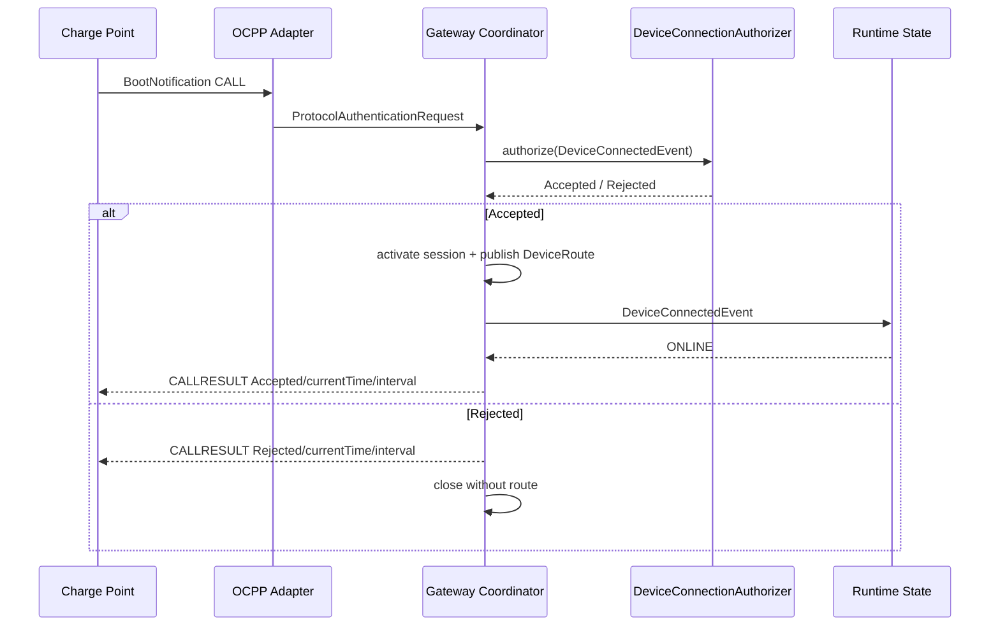

# BootNotification 与 Heartbeat

## Boot 主线

`chargePointVendor` 和 `chargePointModel` 是必填协议元数据，但设备身份始终使用路径中的 `deviceCode`。`currentTime` 使用 UTC `Instant`，`interval` 来自 `voltbridge.protocol.ocpp16.heartbeat-interval`。

## Heartbeat

只有 Boot 已接受的活动会话能处理 Heartbeat。处理器产生现有 `HeartbeatEvent`，由 `HandleHeartbeatUseCase` 刷新同一 `DeviceRuntimeStateStore.lastSeenAt`，响应只包含 UTC `currentTime`。未新建 OCPP 在线状态仓储。
