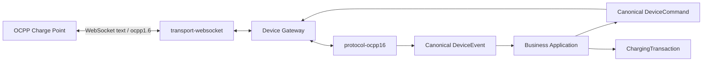

# OCPP 1.6J 核心接入概览

## 阶段范围

VoltBridge 通过 WebSocket 接入 OCPP 1.6 JSON。当前支持上行 `BootNotification`、`Heartbeat`、`StatusNotification`、`StartTransaction`、`MeterValues`、`StopTransaction`，以及下行 `RemoteStartTransaction`、`RemoteStopTransaction`。

不包含 OCPP 2.x、智能充电、预约、固件、诊断、配置管理、授权列表和生产安全配置。业务域仍只有 `ChargingTransaction`，不存在 OCPP 专属交易模型。

## 模块边界

- `voltbridge-transport-websocket`：HTTP Upgrade、`ocpp1.6` 子协议、文本帧、Ping/Pong、关闭和 `TransportSession`。
- `voltbridge-protocol-ocpp16`：OCPP 数组帧、动作处理器、命令映射和 uniqueId 关联。
- `voltbridge-device-gateway`：复用 `DeviceSession`、`DeviceRoute`、`ProtocolRegistry` 和 `DeviceCommandDispatcher`。
- `voltbridge-business-*`：只接收统一命令、事件和设备主动交易端口，不依赖 OCPP/WebSocket 类型。

## 身份与在线语义

设备身份来自 `/ocpp/{deviceCode}`，不从厂商或型号推导。WebSocket 握手只建立未认证传输会话；`BootNotification` 经现有 `DeviceConnectionAuthorizer` 接受后才绑定路由、发布 `DeviceConnectedEvent` 并置为 ONLINE。拒绝 Boot 不留下在线路由。

本地开发可使用 `ws://`。生产必须补充 TLS/WSS、OCPP Security Profile、凭据校验、限流和证书治理。
