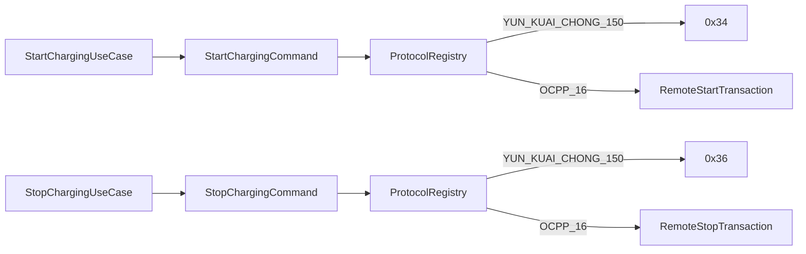

# OCPP 远程启停

## 跨协议命令映射

业务用例和 REST API 不分协议。`DeviceRoute.protocol` 令网关选择适配器；OCPP uniqueId、JSON action 与云快充命令字都停留在协议模块。

## RemoteStartTransaction

`StartChargingCommand.logicalCardNo` 映射为不超过 20 字符的 `idTag`，连接器号映射为 `connectorId`。CALLRESULT `Accepted` 只把 `DeviceCommand` 推进到 `ACKED`；后续 `StartTransaction` 才绑定平台分配的协议交易号、把交易推进到 `CHARGING` 并把命令推进到 `SUCCEEDED`。

## RemoteStopTransaction

`StopChargingCommand.protocolTransactionId` 必须是当前交易持久化的 OCPP 整数，映射为 `transactionId`。CALLRESULT `Accepted` 只把停止命令推进到 `ACKED`，交易保持 `CHARGING`；后续 `StopTransaction` 完成交易，并把等待实际效果的停止命令推进到 `SUCCEEDED`。

## 关联与超时

`Ocpp16PendingRequestRegistry` 保存 `uniqueId -> commandId/deviceId/connector/action`，使用并发映射并按 `request-timeout` 惰性清理。重复响应标记为 duplicate，未知或迟到响应安全忽略。该表只负责短期线协议关联，不替代持久化 `DeviceCommandRepository` 及其超时扫描。
