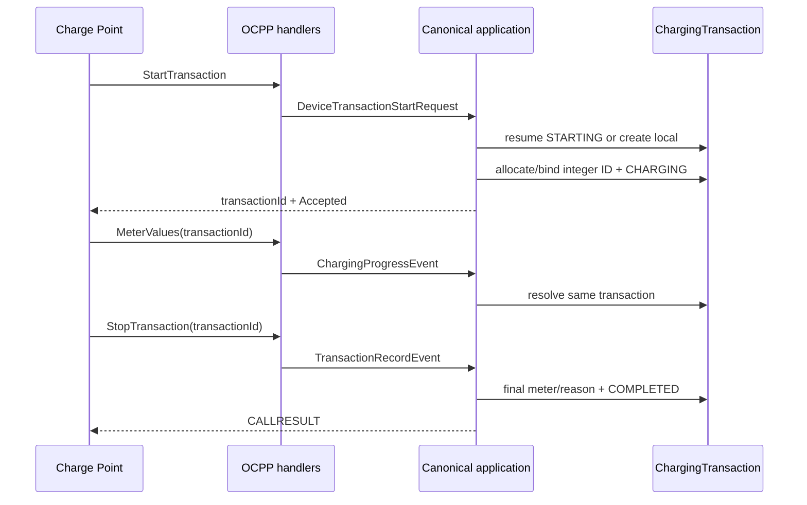

# OCPP 交易生命周期

## StartTransaction

处理器把设备、连接器、开始时间、起始电表 kWh 和未知启动方式提交给协议无关 `DeviceTransactionStartService`。应用层优先复用该连接器现有 `STARTING` 交易；不存在时创建无 `DeviceCommand` 的设备主动交易。

`ProtocolTransactionIdAllocator` 使用 PostgreSQL `protocol_transaction_id_seq` 分配 1 到 `Integer.MAX_VALUE` 的持久化正整数，并写入 `ChargingTransaction.protocolTransactionId`。响应包含该整数和当前简化授权策略 `idTagInfo.status=Accepted`；设备或连接器不存在时返回 `Invalid` 与交易号 0。

## MeterValues 与 StopTransaction

OCPP 的 `StopTransaction` 自身是权威最终记录，不要求云快充式“结束事件后再最终记录”。结束电表由 Wh 转换为 kWh，最终电量可由结束电表减起始电表推导。停止原因映射到统一 `ChargingStopCategory`，原始 reason 保留用于诊断。

本地启动不创建伪命令；远程启动交易保留 `REMOTE` 启动方式并在 StartTransaction 到达后完成启动命令。
