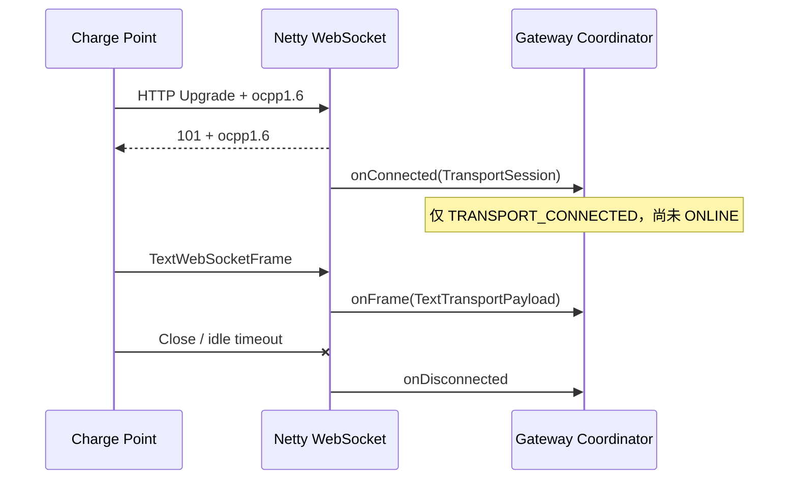

# OCPP WebSocket 传输

## 监听与握手

默认监听 `0.0.0.0:9100`，路径 `/ocpp/{deviceCode}`。客户端必须发送 `Sec-WebSocket-Protocol: ocpp1.6`；未携带、仅携带不支持的子协议或路径缺少设备编码时，服务器以 HTTP 错误拒绝，绝不静默降级。

配置项：

```yaml
voltbridge:
  transport:
    websocket:
      enabled: true
      endpoint-id: ocpp16-websocket
      host: 0.0.0.0
      port: 9100
      path: /ocpp
      max-content-length: 1048576
      idle-timeout: 5m
  protocol:
    ocpp16:
      enabled: true
      heartbeat-interval: 60s
      request-timeout: 30s
```

## 会话生命周期

`WebSocketTransportSession` 只暴露文本 `TransportPayload`、连接属性 `deviceCode`、发送和关闭能力。Netty 的 `Channel`、`WebSocketFrame` 不进入协议或业务层。文本帧进入统一连接协调器；Ping 返回 Pong；二进制帧被拒绝；Close 和空闲断开触发标准会话/路由清理与 `DeviceDisconnectedEvent`。



## 安全边界

当前明文 `ws://` 仅用于本地和集成测试。生产部署前必须使用反向代理或监听器原生 WSS，并实现 OCPP 认证、安全配置文件、来源限制和敏感日志脱敏。
