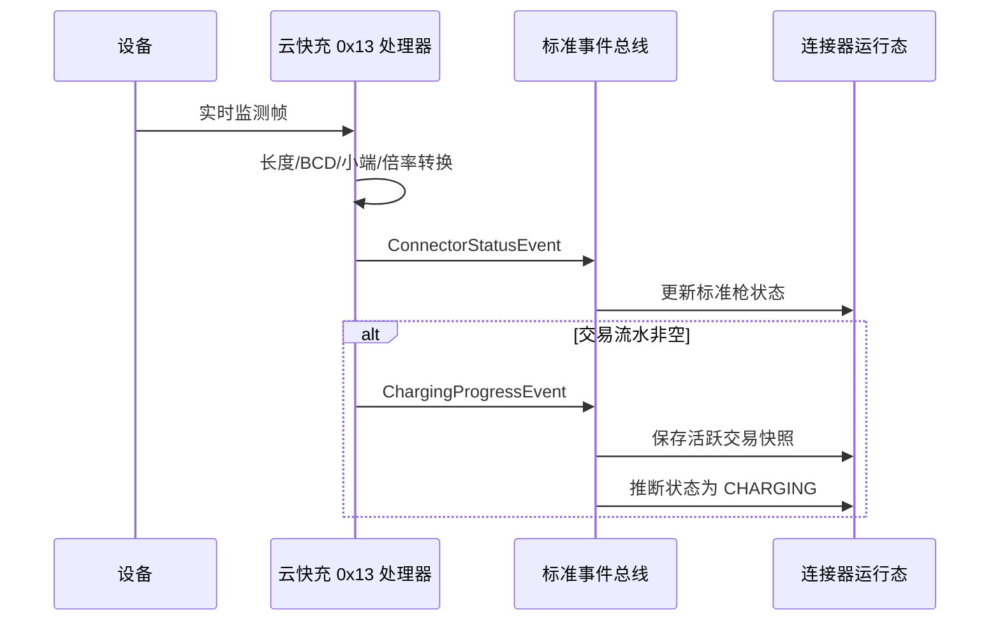

# 云快充 V1.5 充电进度

## 来源与边界

实时监测上行命令 `0x13` 的载荷固定为 60 字节。每帧始终产生 `ConnectorStatusEvent`；仅当 16 字节 BCD 交易流水去除左侧补零后非空时，额外产生 `ChargingProgressEvent`。

## 标准字段

| 标准字段 | 协议字段 | 转换 |
|---|---|---|
| `deviceId` | 7 字节桩编号 | BCD 转 14 位字符串，并校验会话身份 |
| `connectorNo` | 1 字节枪号 | BCD 转 `int` |
| `transactionId` | 16 字节交易流水 | BCD 转字符串并去左侧补零 |
| `outputVoltage` | UINT16 LE | 除以 10，`BigDecimal` |
| `outputCurrent` | UINT16 LE | 除以 10，`BigDecimal` |
| `stateOfCharge` | UINT8 | `Integer` |
| `chargingDuration` | UINT16 LE 分钟 | `Duration.ofMinutes` |
| `energyKwh` | UINT32 LE | 除以 10000，`BigDecimal` |
| `chargingAmount` | UINT32 LE | 除以 10000，`BigDecimal` 元 |
| `occurredAt` | 平台接收时间 | `Instant` |

协议的 BCD、字节序和倍率全部封装在云快充适配器内。业务层不接收协议 DTO，也不使用字符串承载电压、电流、电量或金额。

## 流程

## 暂不处理

- 不执行计费、结算或支付。
- 不把每帧写入 `charging_transaction`。
- 不持久化原始遥测历史。
- 当前按设备编码、枪号和交易流水保存最近快照；后续交易聚合实现后再与持久化交易 ID 对齐。
