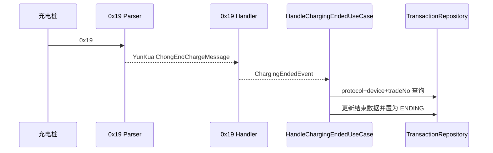

# 云快充 V1.5 结束充电 0x19

## 报文语义

`0x19` 是设备上行的充电结束通知，负载固定 39 字节。它说明充电过程已经结束，但不代表最终交易记录已经持久化，因此业务状态只进入 `ENDING`。

| 字段 | 长度 | 编码/比例 | 平台映射 |
| --- | ---: | --- | --- |
| 交易流水号 | 16 | BCD | `protocolTransactionId` |
| 设备编码 | 7 | BCD | `deviceId` 校验 |
| 枪号 | 1 | BCD | `connectorNo` |
| 结束 SOC | 1 | 无符号整数 | `endSoc` |
| 最小/最大单体电压 | 各 2 | 小端，除以 100 | 规范化电压 |
| 最低/最高温度 | 各 1 | 有符号整数 | 诊断字段 |
| 累计时长 | 2 | 小端，分钟 | `Duration` |
| 输出电量 | 2 | 小端，除以 10 | `energyKwh` |
| 充电机编码 | 4 | BCD | `additionalInfo` |

## 处理链

业务层不依赖云快充 DTO。`0x19` 不要求本阶段下行应答；最终确认由 `0x3B/0x40` 完成。

