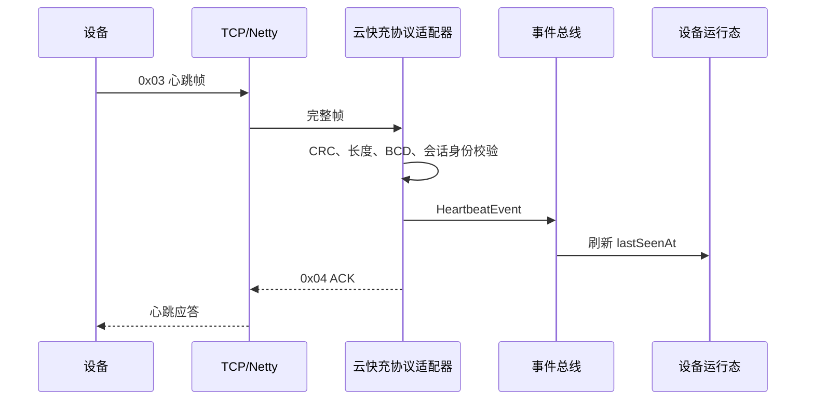

# 云快充 V1.5 心跳

## 命令

- 上行心跳：`0x03`
- 下行应答：`0x04`

## 上行载荷

| 偏移 | 长度 | 类型 | 含义 |
|---:|---:|---|---|
| 0 | 7 | BCD | 14 位设备编码 |
| 7 | 1 | BCD | 枪号 |
| 8 | 1 | UINT8 | 协议原始枪状态，当前仅校验和解析，不传入业务层 |

载荷必须恰好为 9 字节。心跳只能由已登录会话发送，载荷设备编码必须与会话绑定设备一致。

## 应答载荷

应答复用请求序列号、加密标识、设备编码和枪号，最后一字节写 `0x00` 表示成功。

## 处理流程

协议载荷没有设备时间，因此 `HeartbeatEvent.deviceTime` 为 `null`，`occurredAt` 使用平台 `TimeProvider`。
