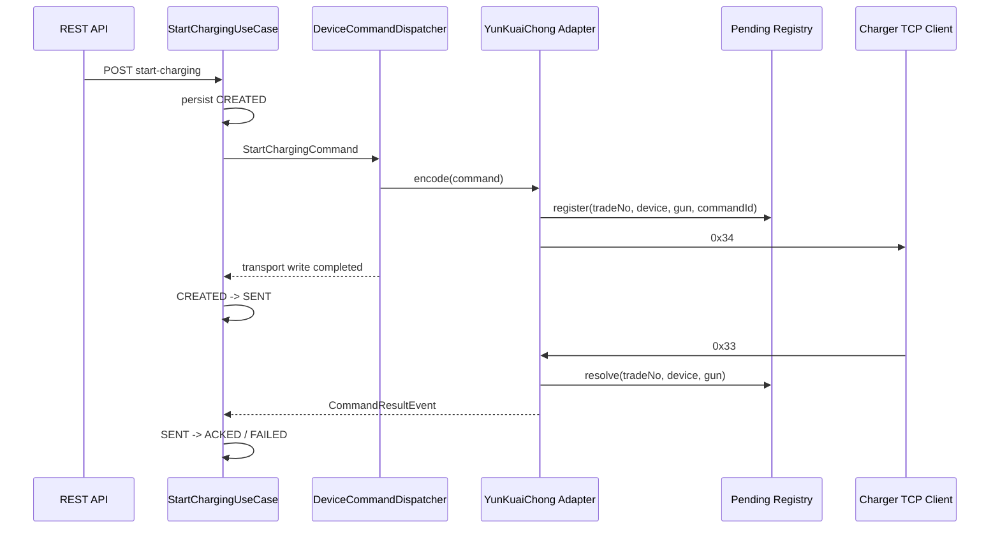

# 云快充 V1.5 远程启动

## 范围

本阶段实现远程启动下行 `0x34` 和远程启动结果上行 `0x33`。协议模块接收统一 `StartChargingCommand`，向业务层发布统一 `CommandResultEvent`；业务层不依赖云快充命令字、BCD、CRC 或 Netty。

## 0x34 映射

帧结构为 `68 | 数据域长度 | 序列号(2) | 加密标志 | 命令字 | 消息体 | CRC16(2)`。当前已验证链路沿用项目既有规则：序列号和 CRC 均高字节在前，CRC16/Modbus 覆盖“序列号至消息体”。

`0x34` 消息体固定 44 字节：

| 偏移 | 长度 | 来源 | 编码 |
| --- | ---: | --- | --- |
| 0 | 16 | `commandId` 派生交易流水 | 32 位十进制 BCD |
| 16 | 7 | `deviceCode` | 14 位 BCD |
| 23 | 1 | `connectorNo` | 2 位 BCD |
| 24 | 8 | `logicalCardNo` | 16 位 BCD；缺省时使用流水号后 16 位 |
| 32 | 8 | `physicalCardNo` | 无符号语义十进制值，64 位小端；缺省为 0 |
| 40 | 4 | `limitAmount` | 分为单位的 32 位小端整数 |

序列号来自当前 `ProtocolContext`，不会在业务层生成。日志包含 `commandId/deviceCode/connectorNo/correlationId`，不记录卡号。

## 0x33 映射

`0x33` 消息体固定 26 字节：

| 偏移 | 长度 | 含义 |
| --- | ---: | --- |
| 0 | 16 | 交易流水，32 位 BCD |
| 16 | 7 | 设备编码，14 位 BCD |
| 23 | 1 | 枪号，2 位 BCD |
| 24 | 1 | 接受标志：`01` 接受，其余为拒绝 |
| 25 | 1 | 失败原因 |

处理器要求消息体长度严格为 26 字节，并校验报文设备编码与已认证会话绑定的设备一致。成功映射为 `CommandResultStatus.ACKED`；失败映射为 `FAILED`，常见原因包括设备编码不匹配、枪忙、设备故障、设备离线和未插枪。

## 关联策略

`0x33` 不可靠地回显下行序列号，但会回显交易流水、设备编码和枪号。因此使用以下协议侧键：

```text
(tradeNo, deviceCode, connectorNo) -> commandId
```

`tradeNo` 由 `SHA-256(commandId) mod 10^32` 生成并左补零为 32 位数字，稳定、可复算且满足 BCD 字段限制。`YunKuaiChongPendingCommandRegistry` 在 `0x34` 编码后登记该键，默认保留 10 分钟，由 `voltbridge.protocol.yunkuaichong.pending-command-retention` 配置。

同一键首次解析标记 `duplicate=false`，后续结果标记 `duplicate=true`。注册表保留已解析项以识别重发；业务聚合只接受合法当前状态的转换，所以重复、冲突和超时后迟到结果都不会覆盖已有状态。未匹配结果只记录告警，不伪造业务命令。

## 完整时序



## 验证样例

固定命令 ID 的协议测试生成：

```text
0x34: 6830000100348978956306306594132320289439982620231212000010015678901234567890D20ACD3AEE2C140088130000B925
0x33: 681E0002003389789563063065941323202894399826202312120000100101004308
```

真实 TCP 集成测试使用动态业务命令 ID，因此交易流水和 CRC 每次运行可以不同；测试会输出当次完整 `INTEGRATION_REMOTE_START_0X34` 与 `INTEGRATION_REMOTE_START_RESULT_0X33`。
