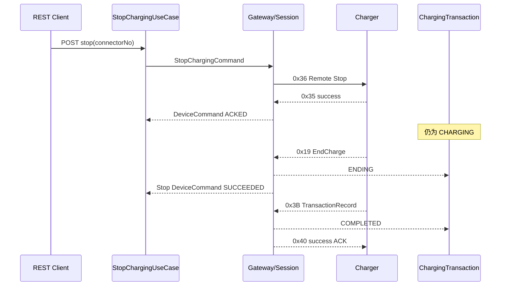

# 云快充 V1.5 远程停充

## 边界与标准模型

业务入口为 `POST /api/devices/{deviceCode}/commands/stop-charging`，请求仅包含 `connectorNo`。`StopChargingUseCase` 定位设备、连接器和唯一活动交易，创建 `STOP_CHARGING` 命令，再发送标准 `StopChargingCommand`：

| 字段 | 含义 |
| --- | --- |
| `commandId` | 平台设备命令 UUID |
| `deviceId` | 平台统一设备编码 |
| `connectorId` | 平台连接器 UUID |
| `connectorNo` | 设备内枪号 |
| `transactionId` | 平台充电交易 UUID |
| `protocolTransactionId` | 已绑定的协议交易流水，可为空 |
| `createdAt` | 命令创建时间 |

协议命令字、序列号、BCD、CRC 和 TCP 会话只存在于云快充适配器。

## 0x36 下行字段

消息体固定 8 字节：

| 偏移 | 长度 | 编码 | 字段 |
| ---: | ---: | --- | --- |
| 0 | 7 | 14 位 BCD | 桩/设备编码 |
| 7 | 1 | 2 位 BCD | 枪号 |

测试固定设备 `20231212000010`、枪号 `01`、序列号 `7` 时完整帧为：

```text
680C0007003620231212000010017C66
```

真实 TCP 集成测试首次停充帧为：

```text
680C000200362023121200001001B077
```

## 0x35 上行字段

消息体固定 10 字节：

| 偏移 | 长度 | 编码 | 字段 |
| ---: | ---: | --- | --- |
| 0 | 7 | 14 位 BCD | 桩/设备编码 |
| 7 | 1 | 2 位 BCD | 枪号 |
| 8 | 1 | 原始字节 | 执行结果，`0x01` 成功，其他失败 |
| 9 | 1 | 原始字节 | 失败原因 |

集成测试成功结果帧：

```text
680E00040035202312120000100101005621
```

协议单测拒绝结果使用 `result=0x00, reason=0x02`。解析后生成标准 `CommandResultEvent`，同时保留 `rawResultCode` 和 `rawFailureCode`。

## 失败映射

| 原始失败码 | 标准失败码 | 含义 |
| --- | --- | --- |
| `0x01` | `DEVICE_MISMATCH` | 设备编码不匹配 |
| `0x02` | `NOT_CHARGING` | 枪未处于充电状态 |
| `0x03` | `COMMAND_REJECTED` | 设备拒绝停充 |
| 其他 | `UNKNOWN` | 未识别厂商失败原因 |

本地化展示文本不作为领域主错误码。

## 命令关联

`0x35` 不回传下行序列号、交易流水或命令 ID，因此实际可用关联键只有：

```text
STOP_CHARGING + deviceCode + connectorNo
```

业务层用交易 UUID 控制同一交易只有一个活动停充命令，数据库部分唯一索引负责并发兜底。协议待处理注册表保存最新命令，并对同一结果的重传累加次数、标记 `duplicate`。它不保存 Channel，也不承担设备路由职责。

## 完整时序



## 超时与幂等

- 默认停充超时为 `30s`，配置键 `voltbridge.device.command.remote-stop-timeout`。
- 超时只产生 `DeviceCommand=TIMEOUT`，不改变交易。
- 迟到或重复 `0x35` 不能覆盖 `ACKED/FAILED/SUCCEEDED/TIMEOUT`。
- `CREATED/SENT/ACKED` 阶段重复点击返回原命令 ID，不重复发送 `0x36`。
- 前一停充命令失败或超时后允许创建新命令；因协议缺少唯一响应流水，重试后的迟到旧响应存在设备侧不可消除的歧义，当前按最新活动命令关联并记录日志。
