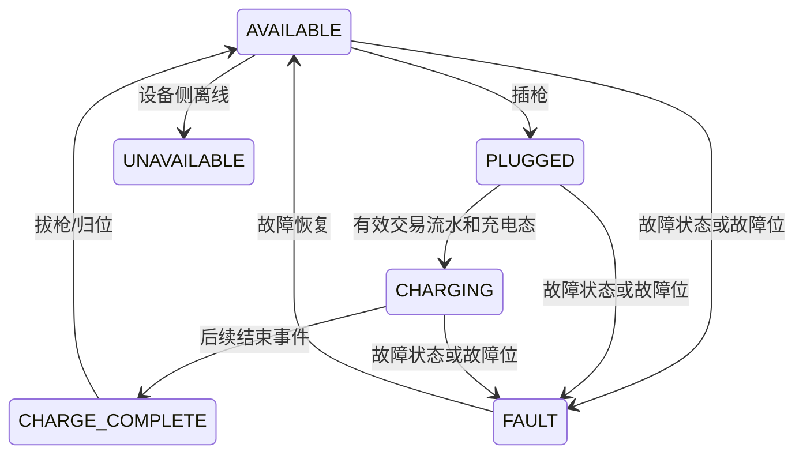

# 云快充 V1.5 枪运行状态

## 来源

枪运行状态来自实时监测上行命令 `0x13`，不是独立命令。协议适配器解析后产出 `ConnectorStatusEvent`，业务层看不到云快充数字码。

## 标准状态映射

| 云快充状态 | 插枪 | 交易流水 | 硬件故障位 | 标准状态 |
|---:|---:|---|---:|---|
| 任意 | 任意 | 任意 | 非 0 | `FAULT` |
| `0x00` 离线 | 任意 | 任意 | 0 | `UNAVAILABLE` |
| `0x01` 故障 | 任意 | 任意 | 0 | `FAULT` |
| `0x02` 空闲 | 否 | 空 | 0 | `AVAILABLE` |
| `0x02` 空闲 | 是 | 空 | 0 | `PLUGGED` |
| `0x03` 充电态 | 任意 | 空 | 0 | `PLUGGED` |
| `0x03` 充电态 | 任意 | 非空 | 0 | `CHARGING` |
| 其他 | 任意 | 任意 | 0 | `UNKNOWN` |

平台枚举同时预留 `CHARGE_COMPLETE`、`RESERVED`，供其他上行命令或未来协议使用。

## 状态机

当前仅实现 `0x13` 可确定的状态，不推测“预约”和“充电完成”。
