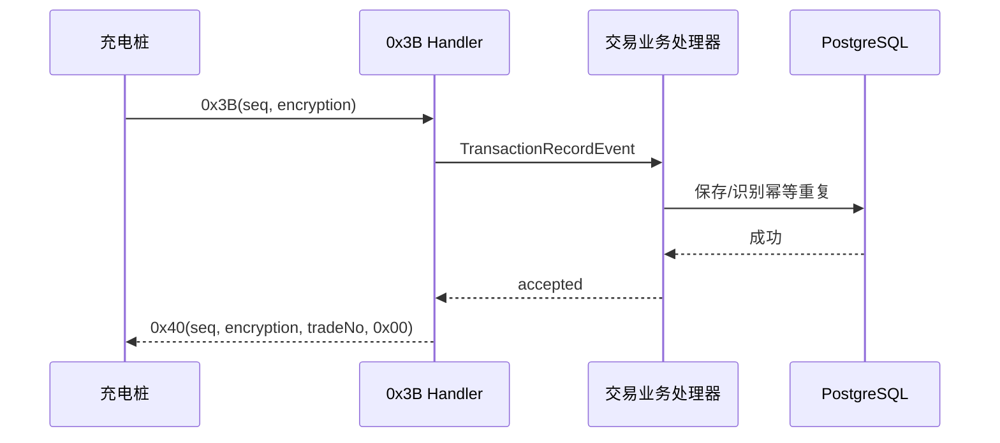

# 云快充 V1.5 交易记录 0x3B / 应答 0x40

## 0x3B 解析

负载固定 158 字节，包含 16 字节 BCD 流水、设备/枪号、CP56Time2a 起止时间、尖峰平谷四组价格/电量/损耗/金额、5 字节小端电表值、总电量/损耗/金额、VIN、启动方式、交易时间、停止码和物理卡号。

比例规则：价格除以 `100000`；分时电量、损耗、金额、总电量和总金额除以 `10000`；5 字节小端电表值除以 `10000`。所有值直接构造 `BigDecimal`，不经过浮点数。CP56Time2a 按配置项 `voltbridge.protocol.yunkuaichong.time-zone` 解释，默认 `Asia/Shanghai`。

平台事件 `TransactionRecordEvent` 保存通用总量及可扩展 `EnergyBreakdownItem` 集合。尖峰平谷不是交易表的固定列，分时明细和损耗进入结构化 `additionalInfo`，便于未来接入其他费率模型。

## 启动方式

| 原始值 | 平台枚举 |
| --- | --- |
| `0x01` | `REMOTE` |
| `0x02` | `CARD` |
| `0x04` | `OFFLINE_CARD` |
| `0x05` | `VIN` |
| 其他 | `UNKNOWN` |

## 停止分类

平台只保留跨协议有意义的分类，同时保存 `rawStopCode` 和诊断详情：

- `0x40` 远程停止；`0x41` 目标 SOC；`0x42` 电量限额；`0x43` 金额限额；`0x44` 时间限额；`0x45` 用户停止。
- `0x50/0x72` 映射急停；BMS 相关码映射 `BMS_FAULT`；通信相关码映射 `COMMUNICATION_TIMEOUT`。
- 车辆请求、掉电和充电机故障分别映射 `VEHICLE_STOP`、`POWER_FAILURE`、`DEVICE_FAULT`。
- 未识别值映射 `OTHER` 或 `UNKNOWN`，不扩张成协议码镜像枚举。

有效最终记录统一使交易进入 `COMPLETED`，异常性由停止分类表达。

## 0x40 应答与重试

`0x40` 负载为原 16 字节交易流水加 1 字节结果，成功为 `0x00`。应答复用 `0x3B` 的序列号和加密标志。

事件发布器当前为进程内同步实现，因此数据库异常会中断处理，成功应答不会提前写出，设备可重试。相同记录重传会再次返回成功；冲突重传保留首份权威数据并输出告警，也返回成功以终止无效重试。

